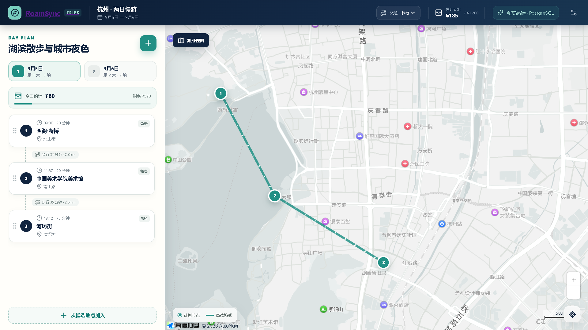
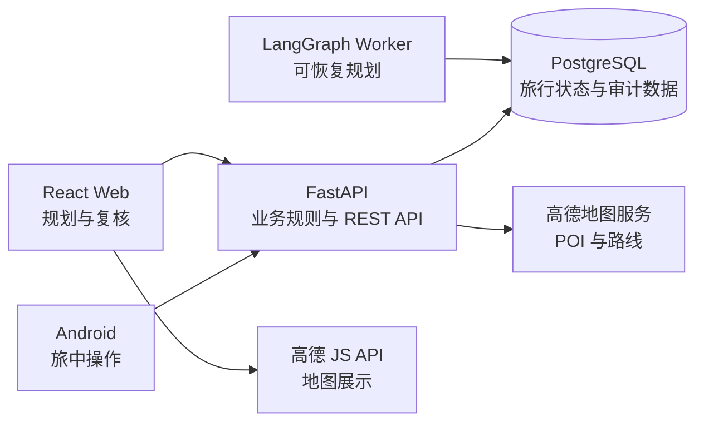

<p align="center"></p>

# RoamSync｜AI 旅行规划与动态行程助手

**严峰的个人项目 · 持续开发中 · Python / FastAPI / LangGraph / PostgreSQL**

把咨询、候选规划、规则校验和用户确认连接到持久化旅行状态。模型产生候选，正式行程由后端校验与事务化服务写入。

[规划工作流代码](backend/app) · [测试](backend/tests) · [Agent 架构](docs/AGENT_ARCHITECTURE.md) · [Web 界面](web/src) · [Android](android)

## 给第一次访问的你

- **重点设计**：确定性路由与 LangGraph、候选 Revision 与正式 Trip 隔离、约束验证、并发版本检查和幂等采用。
- **阅读顺序**：先看下方界面与运行说明，再看 Agent 架构和对应测试；测试数量与供应商质量以特定版本的实测记录为准。
- **当前边界**：已有正式规划与确认流程；V2 自由规划、GPS 和交易能力不因规划文档存在而视为完成。生产质量仍有待改进。
- **公开版本**：从 `E:/Study/RoamSync` 的当前源码整理，包含尚未在原工作区提交的实现；不混入其他实验工作区，不含私有旅行记录、数据库备份、凭证或原始运行轨迹。

## 首次运行

准备 Docker Desktop，按下方环境说明将 `.env.example` 复制为 `.env` 并填写自己的数据库配置、地图和模型密钥，然后在克隆目录执行：

```powershell
docker compose up --build -d
```

访问 `http://127.0.0.1:3000`。先确认 Docker 可用与环境配置完整。`Start-RoamSync.cmd` 是作者本机部署辅助入口；新使用者优先采用上述通用命令，勿依赖作者绝对目录。外部模型与地图接口的可用性、配额和费用由使用者配置。

## 项目详细说明

# RoamSync

正式源码与部署唯一目录：`E:\Study\RoamSync`。其他目录与实验工作区不作为正式部署来源。

启动 Docker Desktop 后，双击本目录的 `Start-RoamSync.cmd`，即可从本目录当前代码重新构建并启动
`roamsync` 项目的 Web、API、Worker 和数据库，保留已有旅行数据。访问 <http://127.0.0.1:3000>。
Docker Desktop 中对 `roamsync` 点击启动，会运行最近一次构建的版本；修改代码后请再次运行脚本更新镜像。
运行 `scripts/verify-roamsync.ps1` 可检查容器部署来源与后端源码是否一致。

2026-09-08 Web 重构：统一旅程入口、精简创建、活动直接完成/跳过与首次规划地点准备已落地。交付范围和未完成项见 [本轮重构记录](docs/WEB_REFACTOR_20260908.md)。

后续已完成模型连接、完整日期覆盖和交通时间修正，并通过真实首次规划与局部调整的确认、刷新验收，见 [真实 AI 流程修复](docs/AI_FLOW_REFACTOR_20260908.md)。

> 面向真实旅行过程的预算感知型双端旅行助手。

RoamSync 将行前规划、旅中执行、预算管理和临时调整放在同一份结构化旅行状态中。项目不只生成一次性攻略，而是持续记录行程、消费与计划变化，为后续的动态重排和多智能体协作建立可靠的数据基础。

当前版本已完成可持久化的 Web 规划工作台、FastAPI/PostgreSQL 后端、可人工确认的 LangGraph 智能规划闭环，以及可连接真实后端的原生 Android 客户端。语音输入、GPS 节点判断和真实酒店/票务交易仍在路线图中。



## 核心理念

- **状态连续**：行程、活动、路线、预算和消费共享同一套后端数据，不让规划与执行脱节。
- **预算优先**：预算是规划约束，而非行程完成后的附加统计。
- **事实可追溯**：地图结果保留服务商标识、坐标和来源记录；外部服务失败时返回明确错误，不虚构结果。
- **变更可控**：活动编辑、移动和旅行修改使用乐观并发控制，冲突不会静默覆盖新数据。
- **用户确认**：Agent 输出先形成候选方案，经规则校验和用户确认后再写入正式计划。

## 当前能力

### Web 规划工作台

- 创建、搜索、编辑、复制、归档和删除旅行。
- 使用高德城市数据保存行政区划代码、城市代码和中心坐标。
- 搜索并保存住宿与景点 POI，记录服务商 ID、地址、区域和坐标。
- 按日期管理活动时间线，支持新增、编辑、删除、跨日移动与拖拽排序。
- 在步行、公交和驾车路线间切换，持久化路线分段并自动顺延后续活动。
- 使用乐观版本号处理并发编辑，过期写入返回 `409 Conflict`。
- 将已跳过活动保留在时间线中，同时从规划预算汇总中排除。
- 编辑结构化规划偏好，包括节奏、兴趣、交通方式、每日时间窗、步行强度和补充要求。
- 提供桌面与横屏平板布局，并包含 Playwright 视觉回归基线。
- 在规划页直接使用 AI 助手提出自然语言调整要求，查看候选方案后接受或拒绝。
- 从“最近方案”恢复已持久化的 Planning Run、澄清或候选版本。
- 在统一旅程内直接完成、跳过活动；默认按日期选择今天，不需要开始或暂停旅行。
- 已移除静态酒店、城际交通、天气与预约预览入口，未接入的交易能力不作为可用功能展示。

### 后端与数据

- FastAPI REST API、OpenAPI 文档和存活/就绪健康检查。
- PostgreSQL 持久化与 Alembic 数据库迁移。
- 旅行、日计划、活动、候选地点、来源、路线、预算与消费数据模型。
- 独立的旅行执行、活动执行和事件日志模型，计划时间与实际时间不会相互覆盖。
- 消费幂等写入、预算汇总和事务一致性。
- 高德 POI/路线服务适配、稳定错误码与数据库缓存。
- 旅行与活动的版本检查、跨日移动和事务化重排。
- 每个旅行独立持久化规划偏好；迁移会为已有旅行补充兼容默认值。
- 提供只读规划上下文，将正式行程、偏好、候选地点、实际预算和规划预算组装为统一契约。
- 独立 PostgreSQL 测试环境，不复用开发数据库。

### 智能规划边界（已完成可恢复工作流骨架）

```text
GET /api/v1/trips/{trip_id}/preferences
PUT /api/v1/trips/{trip_id}/preferences
GET /api/v1/trips/{trip_id}/planning-context
POST /api/v1/trips/{trip_id}/planning-intent/resolve
POST /api/v1/trips/{trip_id}/planning-runs
GET /api/v1/trips/{trip_id}/planning-runs
GET /api/v1/planning-runs/{run_id}
GET /api/v1/planning-runs/{run_id}/revision
POST /api/v1/planning-runs/{run_id}/decision
POST /api/v1/plan-revisions/{revision_id}/reject
POST /api/v1/plan-revisions/{revision_id}/accept
GET /api/v1/trips/{trip_id}/execution
POST /api/v1/trips/{trip_id}/execution/start
POST /api/v1/trip-executions/{execution_id}/actions
```

`planning-context` 是后续 Planner 与 Replanner 的统一只读输入。意图解析接口使用
版本化的 `rules-v1` 高精度路由，结合页面选中项和数据库实体解析日期、时间段、
地点查询及需要保护的活动；不支持、缺失或有歧义的请求会返回明确的澄清问题。
它不会调用模型，也不会让 Agent 直接修改正式活动。

`planning-runs` 与 `plan-revisions` 已建立持久化边界。运行会记录正式旅行的基础
版本，经过严格结构校验的候选才能进入等待确认状态；旅行版本变化后，旧运行不能
覆盖正式计划。候选版本会保存相邻活动的路线证据；接受时后端会再次检查日期、地点
归属、来源、时间窗、活动重叠、交通时间、每日与总预算，以及已完成、进行中和锁定
活动保护，然后在单个事务中应用活动与路线。重复接受保持幂等。

LangGraph 负责串联意图解析、澄清、候选生成、确定性校验和用户审批。图状态通过
PostgreSQL checkpoint 持久化；即使 API 或 Worker 重启，仍可使用同一个
`planning_run` 恢复。澄清最多两轮，审批只接受 `accept` 或 `reject`，正式计划仍然
只能通过既有的事务化接受服务写入。

Planner 默认接入 BigModel 的 GLM Chat Completions API，模型标识为 `glm-5.3-flash`。
GLM 使用 JSON Object 输出模式，结构要求作为模型指引发送，并由后端 Pydantic 与业务规则继续严格校验。模型只
能从后端提供的地点 ID 和旅行日期中编排时间；地点费用、来源和路线不会由模型生成，
而是由后端回填并再次执行确定性校验。JSON Schema 输出还会经过 Pydantic 二次校验，
未知地点、日期越界和重复地点均不能进入候选版本。调用的供应商、模型和 token 总量
记录在 `planning_runs` 中，API Key 仅从被 Git 忽略的 `.env` 注入。首次候选未通过
硬约束时，Reviewer 会把具体校验错误交给 Planner 修正一次；第二次仍失败则以
`planner_constraints_unsatisfied` 结束，不会放宽或跳过校验。

Checkpoint 初始化会幂等执行，Agent Worker 已纳入默认 Compose 启动。完成 `.env`
的 `PLANNER_API_KEY` 配置后，`docker compose up -d --build` 即可启动完整闭环。

### 旧执行接口（Web 已停用整趟旅行控制）

旧执行协议仍使用 `trip_executions`、`activity_executions` 和 `travel_events` 保存实际执行状态。
开始旅行后，用户可依次记录到达、开始、完成或跳过活动，也可暂停和恢复旅行。API 只允许
更新当前活动，旅行暂停时拒绝活动操作，仍有未处理活动时拒绝提前结束。执行动作会同步
现有活动的 `active/completed/skipped` 状态，但计划时间、路线和预计费用保持原始规划含义。
这些接口保留供旧客户端兼容；新版 Web 通过活动接口记录完成/跳过，不再暴露该执行模式。GPS 自动判断及双端事件迁移尚未实现。

### Android 客户端

- Kotlin + Jetpack Compose 原生应用。
- Hilt 依赖注入、Retrofit 网络访问、StateFlow 状态管理和 DataStore 本地偏好。
- 0.2.0 重做原生行程首页、按天行程、活动编辑、高德地图、预算与记账页面。
- 首页和行程内共用旅程总管：咨询、创建旅行、改期、候选方案预览、确认保存、澄清与历史恢复，与 Web 共用正式行程和会话接口。
- AI 方案保存后重新读取正式行程；回到前台或点击刷新可同步 Web 更新。
- Debug 构建支持通过 USB 设备访问本机 Docker API。

## 系统架构



| 层级 | 技术栈 | 主要职责 |
| --- | --- | --- |
| Web | React 19、TypeScript、Vite、Vitest、Playwright | 旅行目录、规划工作台、地图、时间线和来源复核 |
| Android | Kotlin、Jetpack Compose、Hilt、Retrofit、DataStore | 旅中操作、预算与消费入口 |
| API | FastAPI、Pydantic、SQLAlchemy Async、Alembic | API、业务校验、事务、幂等和并发控制 |
| 数据 | PostgreSQL 17 | 旅行、活动、路线、预算、消费与来源持久化 |
| 基础设施 | Docker Compose、Nginx | 本地编排、服务健康检查和 Web 托管 |

## 项目结构

```text
RoamSync/
├── android/                 # 原生 Android 客户端
├── backend/                 # FastAPI 服务、迁移与测试
│   ├── app/
│   ├── migrations/
│   └── tests/
├── docs/                    # 策划、需求与调研文档
├── web/                     # React Web 应用与端到端测试
├── compose.yaml             # 开发环境
├── compose.test.yaml        # 隔离测试环境
└── THIRD_PARTY_NOTICES.md   # 第三方项目与归属说明
```

## 快速开始

### 环境要求

- Docker Desktop（包含 Docker Compose）
- Git
- 可选：高德地图 Web JS API Key、Security Code 和 Web 服务 REST Key

### 1. 配置环境变量

```powershell
Copy-Item .env.example .env
```

根据需要修改 `.env`：

| 变量 | 用途 | 默认值 |
| --- | --- | --- |
| `POSTGRES_DB` | 开发数据库名 | `roamsync` |
| `POSTGRES_USER` | 数据库用户 | `roamsync` |
| `POSTGRES_PASSWORD` | 本地开发密码 | `123123` |
| `POSTGRES_HOST_PORT` | PostgreSQL 本机端口 | `54329` |
| `API_HOST_PORT` | API 本机端口 | `8000` |
| `WEB_HOST_PORT` | Web 本机端口 | `3000` |
| `AMAP_WEB_KEY` | 高德 Web JS API Key | 空 |
| `AMAP_SECURITY_CODE` | 高德 Web 安全密钥 | 空 |
| `AMAP_REST_KEY` | 高德 Web 服务 REST Key | 空 |
| `ROAMSYNC_TAVILY_API_KEY` | 目的地网页检索密钥，优先于系统环境中的旧 `TAVILY_API_KEY` | 空 |
| `ROUTE_CACHE_TTL_SECONDS` | 路线缓存有效期 | `86400` |
| `ALLOW_MAP_ESTIMATES` | 是否允许测试性路线估算 | `false` |

> `.env.example` 中的数据库口令仅供本地开发。部署到共享或公开环境前必须更换，并确保真实 `.env` 不进入版本控制。

### 2. 启动完整服务

```powershell
docker compose up -d --build
docker compose ps
```

启动后可访问：

- Web：<http://127.0.0.1:3000/trips>
- 杭州演示：<http://127.0.0.1:3000/demo>
- API：<http://127.0.0.1:8000>
- OpenAPI：<http://127.0.0.1:8000/docs>

汇报前的完整启动、演示顺序和异常预案见 [演示手册](docs/DEMO_RUNBOOK.md)。
- PostgreSQL：`127.0.0.1:54329`

容器默认不会开机自启。可手动控制服务：

```powershell
docker compose start
docker compose stop
```

### 3. 初始化演示数据（可选）

种子命令具有幂等性；添加 `--reset` 时会重建固定的杭州演示数据：

```powershell
docker compose exec api uv run --no-sync python -m app.seed_demo --reset
```

## 本地开发

### Web

日常使用只需启动 Docker Web，旅行工作台与 Agent 监控台统一在 3000。

开发时保持 Docker API 运行，先停止占用 3000 的 Web 容器，再启动同一套源码的 Vite 服务（端口被占用会报错，不会切换到另一个端口）：

```powershell
docker compose stop web
```

```powershell
Set-Location web
pnpm install --frozen-lockfile
pnpm dev
```

开发地址：<http://127.0.0.1:3000/trips>；监控台：<http://127.0.0.1:3000/dev/agent-monitor>。

结束开发后停止 Vite，在项目根目录运行 `docker compose up -d --build web`，将最新源码更新到 3000 的正式页面。

创建旅行前的旅程总管提供“清除对话”：清空本次咨询和待确认创建预览，以新会话重新讨论目的地。确认创建后，对话仍随旅行保存；该按钮不会删除已保存旅行的历史。

如需真实地图底图，将 `web/.env.example` 复制为 `web/.env.local`，并填写：

```dotenv
VITE_AMAP_WEB_KEY=your_web_js_api_key
VITE_AMAP_SECURITY_CODE=your_security_js_code
```

高德 REST Key 仅配置在根目录 `.env` 中，不会发送到浏览器。未配置地图密钥时，界面会显示配置提示；生产数据不会静默替换为估算值。

### Android

使用 Android Studio 打开 `android/` 目录。Debug 构建从根目录 `.env` 的 `ANDROID_API_BASE_URL` 读取后端地址，未设置时连接 `http://127.0.0.1:8000/`。

手机热点或同一局域网连接：将该配置设为电脑 Wi-Fi 网卡的 IPv4，例如 `ANDROID_API_BASE_URL=http://10.106.242.159:8000/`，然后重新构建并覆盖安装 Debug APK。电脑连接手机热点时，也使用电脑的地址，不使用手机热点网关地址。API 的 Docker 端口已监听电脑所有网卡；此方式不需要 USB 转发。热点重连后电脑 IP 可能变化，届时更新配置并重新安装。

USB 调试设备可通过 ADB 反向代理访问本机 API：

```powershell
adb reverse tcp:8000 tcp:8000
```

使用 JDK 17 构建和测试：

```powershell
Set-Location android
./gradlew.bat testDebugUnitTest assembleDebug
```

0.2.0 移动端重构与验收记录见 [MOBILE_REFACTOR_20260909.md](docs/MOBILE_REFACTOR_20260909.md)。地图使用根目录 `.env` 中已有的 `AMAP_WEB_KEY` 和 `AMAP_SECURITY_CODE`（前端地图配置），不会把后端模型或 REST 密钥写入 APK。

## 测试与质量检查

### 后端集成测试

测试使用独立的临时 PostgreSQL 实例，不会写入开发数据库：

```powershell
docker compose -f compose.test.yaml up --build --abort-on-container-exit --exit-code-from api-test
docker compose -f compose.test.yaml down -v
```

### Web 检查

```powershell
Set-Location web
pnpm lint
pnpm typecheck
pnpm test
pnpm build
pnpm e2e
```

视觉回归覆盖 `1440×900` 桌面和 `1024×768` 横屏平板尺寸。

## 一致性与安全边界

- `.env`、Android 本地配置、虚拟环境、构建产物和依赖目录均被 Git 忽略。
- POI 搜索本身不写入规划数据；只有用户确认加入行程后，地点快照和来源记录才会在同一事务中保存。
- 活动更新和移动使用版本号防止并发覆盖。
- 跨日移动同时锁定两个日计划，失败时保持原行程不变。
- 高德额度、凭据、配置、服务拒绝和网络错误使用不同错误码，响应不会暴露 API Key。
- 真实位置轨迹、消费记录和私人旅行计划不应提交到公开仓库。

## 路线图

以下内容来自一期产品策划，尚不代表当前版本已经完成：

- [x] 建立 LangGraph 状态图、PostgreSQL Checkpoint 与 Interrupt/Resume 骨架。
- [x] 接入真实 DeepSeek Planner、确定性 Reviewer 与严格结构化输出。
- [ ] 生成受预算、日期、住宿、营业时间和路线约束的候选攻略。
- [ ] 支持语音/文字消费解析，并在确认后幂等写入。
- [x] 根据天气、延迟、疲劳或预算变化发起动态重规划，仅重排尚未完成的活动。
- [ ] 在 Android 端结合地理围栏、停留时长和移动状态判断节点进度。
- [ ] 引入 Web Search、天气和用户主动分享内容的来源复核流程。
- [ ] 建立 Agent 约束评测、密钥扫描、许可证检查和持续集成。
- [ ] 增强弱网缓存、离线今日行程和待同步消费能力。

## 项目文档

- RoamSync 项目策划书（原始课程文档未纳入公开版）
- RoamSync 用户需求分析（原始课程文档未纳入公开版）
- [参考项目调研与许可边界](docs/REFERENCE_RESEARCH.md)
- [Agent 架构与权限真源](docs/AGENT_ARCHITECTURE.md)
- [第三方声明](THIRD_PARTY_NOTICES.md)

## 许可与第三方归属

第三方项目的参考方式、许可证与使用边界记录在 [THIRD_PARTY_NOTICES.md](THIRD_PARTY_NOTICES.md) 中。TREK 等强 Copyleft 项目仅作为产品与交互研究来源，本仓库不包含其源码或素材。

项目自身的发布许可证尚未确定。在添加正式 `LICENSE` 文件前，不应默认获得复制、分发或再许可本项目代码的权利。
