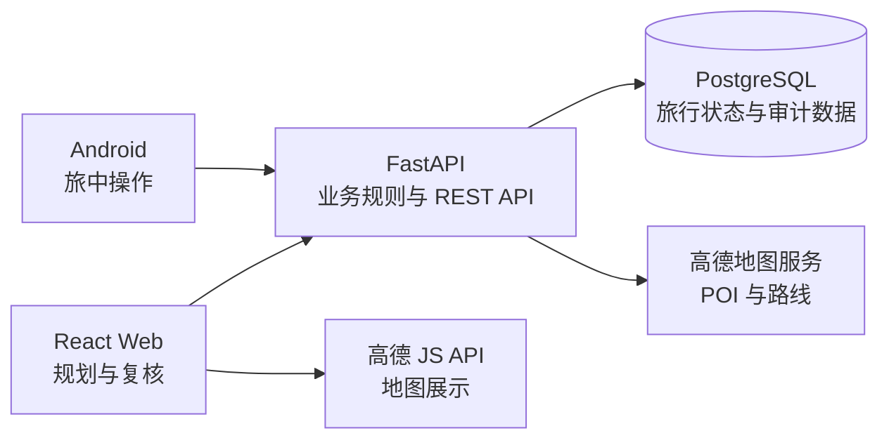

# RoamSync

> 面向真实旅行过程的预算感知型双端旅行助手。

RoamSync 将行前规划、旅中执行、预算管理和临时调整放在同一份结构化旅行状态中。项目不只生成一次性攻略，而是持续记录行程、消费与计划变化，为后续的动态重排和多智能体协作建立可靠的数据基础。

当前版本已完成可持久化的 Web 规划工作台、FastAPI/PostgreSQL 后端，以及可连接真实后端的原生 Android 客户端。Agent 工作流、语音输入、GPS 节点判断等能力仍在路线图中。


## 核心理念

- **状态连续**：行程、活动、路线、预算和消费共享同一套后端数据，不让规划与执行脱节。
- **预算优先**：预算是规划约束，而非行程完成后的附加统计。
- **事实可追溯**：地图结果保留服务商标识、坐标和来源记录；外部服务失败时返回明确错误，不虚构结果。
- **变更可控**：活动编辑、移动和旅行修改使用乐观并发控制，冲突不会静默覆盖新数据。
- **用户确认**：未来的 Agent 输出将先形成候选方案，经规则校验和用户确认后再写入正式计划。

## 当前能力

### Web 规划工作台

- 创建、搜索、编辑、复制、归档和删除旅行。
- 使用高德城市数据保存行政区划代码、城市代码和中心坐标。
- 搜索并保存住宿与景点 POI，记录服务商 ID、地址、区域和坐标。
- 按日期管理活动时间线，支持新增、编辑、删除、跨日移动与拖拽排序。
- 在步行、公交和驾车路线间切换，持久化路线分段并自动顺延后续活动。
- 使用乐观版本号处理并发编辑，过期写入返回 `409 Conflict`。
- 将已跳过活动保留在时间线中，同时从规划预算汇总中排除。
- 提供桌面与横屏平板布局，并包含 Playwright 视觉回归基线。

### 后端与数据

- FastAPI REST API、OpenAPI 文档和存活/就绪健康检查。
- PostgreSQL 持久化与 Alembic 数据库迁移。
- 旅行、日计划、活动、候选地点、来源、路线、预算与消费数据模型。
- 消费幂等写入、预算汇总和事务一致性。
- 高德 POI/路线服务适配、稳定错误码与数据库缓存。
- 旅行与活动的版本检查、跨日移动和事务化重排。
- 独立 PostgreSQL 测试环境，不复用开发数据库。

### Android 客户端

- Kotlin + Jetpack Compose 原生应用。
- Hilt 依赖注入、Retrofit 网络访问、StateFlow 状态管理和 DataStore 本地偏好。
- 后端健康检查、旅行创建、预算设置、消费记录与余额刷新。
- Debug 构建支持通过 USB 设备访问本机 Docker API。

## 系统架构



| 层级 | 技术栈 | 主要职责 |
| --- | --- | --- |
| Web | React 19、TypeScript、Vite、Vitest、Playwright | 旅行目录、规划工作台、地图、时间线和来源复核 |
| Android | Kotlin、Jetpack Compose、Hilt、Retrofit、DataStore | 旅中操作、预算与消费入口 |
| API | FastAPI、Pydantic、SQLAlchemy Async、Alembic | API、业务校验、事务、幂等和并发控制 |
| 数据 | PostgreSQL 17 | 旅行、活动、路线、预算、消费与来源持久化 |
| 基础设施 | Docker Compose、Nginx | 本地编排、服务健康检查和 Web 托管 |

## 项目结构

```text
RoamSync/
├── android/                 # 原生 Android 客户端
├── backend/                 # FastAPI 服务、迁移与测试
│   ├── app/
│   ├── migrations/
│   └── tests/
├── docs/                    # 策划、需求与调研文档
├── web/                     # React Web 应用与端到端测试
├── compose.yaml             # 开发环境
├── compose.test.yaml        # 隔离测试环境
└── THIRD_PARTY_NOTICES.md   # 第三方项目与归属说明
```

## 快速开始

### 环境要求

- Docker Desktop（包含 Docker Compose）
- Git
- 可选：高德地图 Web JS API Key、Security Code 和 Web 服务 REST Key

### 1. 配置环境变量

```powershell
Copy-Item .env.example .env
```

根据需要修改 `.env`：

| 变量 | 用途 | 默认值 |
| --- | --- | --- |
| `POSTGRES_DB` | 开发数据库名 | `roamsync` |
| `POSTGRES_USER` | 数据库用户 | `roamsync` |
| `POSTGRES_PASSWORD` | 本地开发密码 | `123123` |
| `POSTGRES_HOST_PORT` | PostgreSQL 本机端口 | `54329` |
| `API_HOST_PORT` | API 本机端口 | `8000` |
| `WEB_HOST_PORT` | Web 本机端口 | `3000` |
| `AMAP_WEB_KEY` | 高德 Web JS API Key | 空 |
| `AMAP_SECURITY_CODE` | 高德 Web 安全密钥 | 空 |
| `AMAP_REST_KEY` | 高德 Web 服务 REST Key | 空 |
| `ROUTE_CACHE_TTL_SECONDS` | 路线缓存有效期 | `86400` |
| `ALLOW_MAP_ESTIMATES` | 是否允许测试性路线估算 | `false` |

> `.env.example` 中的数据库口令仅供本地开发。部署到共享或公开环境前必须更换，并确保真实 `.env` 不进入版本控制。

### 2. 启动完整服务

```powershell
docker compose up -d --build
docker compose ps
```

启动后可访问：

- Web：<http://127.0.0.1:3000/trips>
- API：<http://127.0.0.1:8000>
- OpenAPI：<http://127.0.0.1:8000/docs>
- PostgreSQL：`127.0.0.1:54329`

容器默认不会开机自启。可手动控制服务：

```powershell
docker compose start
docker compose stop
```

### 3. 初始化演示数据（可选）

种子命令具有幂等性；添加 `--reset` 时会重建固定的杭州演示数据：

```powershell
docker compose exec api uv run --no-sync python -m app.seed_demo --reset
```

## 本地开发

### Web

保持 Docker API 运行，然后启动 Vite：

```powershell
Set-Location web
pnpm install --frozen-lockfile
pnpm dev
```

开发地址：<http://127.0.0.1:5173/trips>

如需真实地图底图，将 `web/.env.example` 复制为 `web/.env.local`，并填写：

```dotenv
VITE_AMAP_WEB_KEY=your_web_js_api_key
VITE_AMAP_SECURITY_CODE=your_security_js_code
```

高德 REST Key 仅配置在根目录 `.env` 中，不会发送到浏览器。未配置地图密钥时，界面会显示配置提示；生产数据不会静默替换为估算值。

### Android

使用 Android Studio 打开 `android/` 目录。Debug 构建默认连接 `http://127.0.0.1:8000`。

USB 调试设备可通过 ADB 反向代理访问本机 API：

```powershell
adb reverse tcp:8000 tcp:8000
```

使用 JDK 17 构建和测试：

```powershell
Set-Location android
./gradlew.bat testDebugUnitTest assembleDebug
```

## 测试与质量检查

### 后端集成测试

测试使用独立的临时 PostgreSQL 实例，不会写入开发数据库：

```powershell
docker compose -f compose.test.yaml up --build --abort-on-container-exit --exit-code-from api-test
docker compose -f compose.test.yaml down -v
```

### Web 检查

```powershell
Set-Location web
pnpm lint
pnpm typecheck
pnpm test
pnpm build
pnpm e2e
```

视觉回归覆盖 `1440×900` 桌面和 `1024×768` 横屏平板尺寸。

## 一致性与安全边界

- `.env`、Android 本地配置、虚拟环境、构建产物和依赖目录均被 Git 忽略。
- POI 搜索本身不写入规划数据；只有用户确认加入行程后，地点快照和来源记录才会在同一事务中保存。
- 活动更新和移动使用版本号防止并发覆盖。
- 跨日移动同时锁定两个日计划，失败时保持原行程不变。
- 高德额度、凭据、配置、服务拒绝和网络错误使用不同错误码，响应不会暴露 API Key。
- 真实位置轨迹、消费记录和私人旅行计划不应提交到公开仓库。

## 路线图

以下内容来自一期产品策划，尚不代表当前版本已经完成：

- [ ] 接入 LangGraph Planner、Reviewer、Checkpoint 与 Interrupt 工作流。
- [ ] 生成受预算、日期、住宿、营业时间和路线约束的候选攻略。
- [ ] 支持语音/文字消费解析，并在确认后幂等写入。
- [ ] 根据午睡、天气、延迟或超支，仅重排尚未完成的活动。
- [ ] 在 Android 端结合地理围栏、停留时长和移动状态判断节点进度。
- [ ] 引入 Web Search、天气和用户主动分享内容的来源复核流程。
- [ ] 建立 Agent 约束评测、密钥扫描、许可证检查和持续集成。
- [ ] 增强弱网缓存、离线今日行程和待同步消费能力。

## 项目文档

- [RoamSync 项目策划书](docs/RoamSync项目策划书.docx)
- [RoamSync 用户需求分析](docs/RoamSync用户需求分析.docx)
- [参考项目调研与许可边界](docs/REFERENCE_RESEARCH.md)
- [第三方声明](THIRD_PARTY_NOTICES.md)

## 许可与第三方归属

第三方项目的参考方式、许可证与使用边界记录在 [THIRD_PARTY_NOTICES.md](THIRD_PARTY_NOTICES.md) 中。TREK 等强 Copyleft 项目仅作为产品与交互研究来源，本仓库不包含其源码或素材。

项目自身的发布许可证尚未确定。在添加正式 `LICENSE` 文件前，不应默认获得复制、分发或再许可本项目代码的权利。
