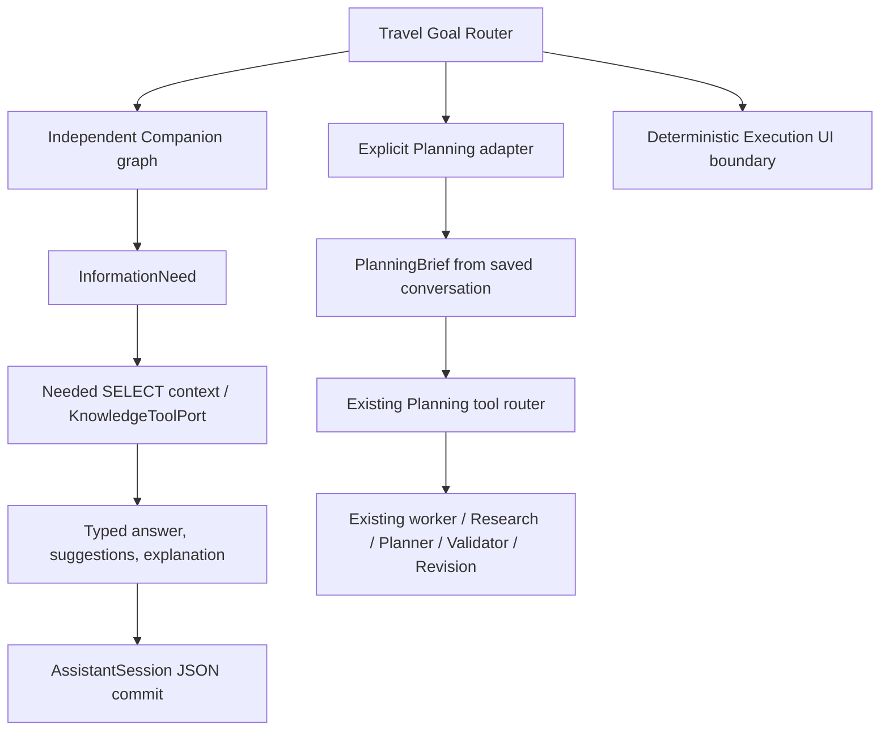

# Travel Companion Agent — Phase 1

Date: 2026-09-29. Status: implementation and isolated regression COMPLETE.

Evidence labels: VERIFIED = code/contracts/integration assertions; MEASURED = recorded run output; INFERRED = design conclusion. The working tree was already dirty: HEAD `5572849` on `main`, 60 modified tracked paths plus substantial untracked prior work. This report describes this round's edits, not the complete `git diff HEAD`. No commit, migration, deployment or Demo reset was performed.

## 1. Current Architecture Audit

VERIFIED: Phase 0 routed Companion separately but used a bounded lightweight answer path. `send_message` still listed trips and loaded recent PlanningRuns before branching. It had no structured Suggestion identity, independent graph, persisted explanation contract or PlanningBrief. The existing Planning workflow already used LangGraph, a leased worker, PostgreSQL checkpoints, strict request-local entity resolution, validators and user approval.

AssistantSession already stores messages in JSON and uses message IDs plus session row locking for retries. Its existing column can hold additive typed metadata. Decision Ledger is still shadow/OPEN. Persisted `PlanRevision.difference_summary.decision_summary` can be validated, invalid or unavailable; the presence of a Revision alone proves no original rationale.

MEASURED fresh baseline before edits: Linux/Python 3.11/PostgreSQL 17, migrations plus full suite, **405 passed / 0 failed / 2 existing warnings, 46.33s**. This was measured again in this turn, not copied from Phase 0. Baseline log and JUnit are in `backend/evals/results/companion_phase1/`.

VERIFIED parallel-work audit: Tourism Knowledge uses separate worktree `E:\Study\RoamSync-tourism-knowledge`, branch `codex/tourism-knowledge-phase-a`. It progressed from `0fab288` to clean completed HEAD `5023a28`. This round did not edit, import or merge its `backend/app/tourism_knowledge` files. Current source and its public request/result interface were inspected read-only.

## 2. Runtime Decision

Companion now has its own `CompanionRuntime`, graph state, goal restrictions, context, model draft, result, interaction state and runtime eval. It is a sibling of Planning, not a Planning node. LangGraph is already a project dependency; a short fixed graph makes information needs, read permissions, generation and handoff boundaries inspectable without adding an execution framework.

Graph stages: interpret goal → resolve conversation → determine information need → gather read-only context → generate → extract interaction outcome → reject self-authorized handoff → prepare persistence. The service owns the actual session commit. `runtime_trace` records short stage names, not hidden reasoning. Invocation is bounded with recursion limit 16. No background loop or Companion checkpoint store is needed for this synchronous turn; durable messages reconstruct state after reload.

The Companion provider has its own system prompt and `CompanionDraft` schema. It reuses bottom-level model transport/JSON helpers, not the Planning prompt. A configuration-free fallback offers three experience directions rather than inventing verified POIs. Mixed explicit mutation requests remain Router/Planning responsibility. Only two blocking rule expressions were extended (`给我`, `放进去`); no classifier or taxonomy rewrite.

## 3. CompanionContext

CompanionContext includes current message/goal, at most 12 recent text turns, destination, selected identities, bounded conversation preferences and prior suggestions, optional Trip summary, optional itinerary summary, optional saved decision and knowledge evidence. Automatic summary generation is deferred; `conversation_summary` is currently empty. Pending handoff is removed before generation so a later chat cannot inherit Planning authority.

| Request | Additional reads / context | Excluded reads |
| --- | --- | --- |
| 西湖有什么历史？ | `history_culture` need; optional knowledge port | Trip preferences, itinerary, PlanningRun, execution, routes, validator |
| 杭州适合我吗？ / 偏好建议 | Conversation preferences; Trip title/destination only when needed; saved preference SELECT | Full PlanningContext, missing-preference repair, routes/locks/revision state |
| 第二个为什么值得去？ | Exact saved Suggestion and its originating turn/reasons | Formal schedule justification inferred from that Suggestion |
| 为什么之前把西湖放在晚上？ | Narrow itinerary SELECT; only one identified item permits targeted accepted decision summary SELECT | Execution state, checkpoints, model reasoning, arbitrary run history |

All reader SQL uses `autoflush=False`; missing preference rows remain absent. Itinerary summary selects identity/name/date/time, scoped to the Trip and limited to 10. Exact mentions narrow rows; duplicate names never select a guessed identity. Formal explanation may read PlanningRun/PlanRevision specifically for the saved accepted decision; the no-Planning-read guarantee applies to ordinary history/culture requests, not every possible explanation.

## 4. Interaction Contracts

Contracts are frozen Pydantic models with forbidden extra fields. Model-facing `CompanionDraft` contains answer, proposed suggestions, comparison and known evidence references. It cannot output server IDs, interaction authorization, original rationale or Planning handoff.

| Contract | Implemented meaning |
| --- | --- |
| CompanionSuggestion | Server identity, type/title/summary, typed entity refs, destination, reasons/evidence, creation turn/time, grounding and status |
| CompanionResult | Seven Companion goals, answer/status, suggestions, resolved refs/interactions, comparison, explanation, information need/gaps, short trace |
| CompanionExplanation | Original saved Suggestion vs original validated formal decision vs current reconstruction vs rationale unavailable; source refs and freshness warning |
| InformationNeed | Knowledge/types, live facts/types, search, decision history, Trip/preferences/itinerary needs |
| PlanningBrief | Explicit authorization turn, raw request/dates/party/budget, duration, preferences/avoidances, candidate interests, must-do, decisions/open questions, source and Suggestion refs |
| KnowledgeToolPort | Read-only request/result with bounded evidence, source reference, knowledge type and stable/semi-stable scope |

`current_reconstruction` is representable but this round returns `rationale_unavailable` instead of generating speculative original-looking reasons. Original explanation requires a saved subject, reasons and proper turn/Revision source. `CompanionResult.planning_handoff` must be null: the explicit Planning adapter owns creation of a Brief.

## 5. State & Identity

Persist `messages[].companion_result` and `messages[].planning_brief` in existing JSON; no new table. Project all saved turns into a durable Suggestion registry/current batch/focus, while limiting model-visible recent prose to 12 turns. IDs are deterministic UUID5 strings over session, message ID and batch index; retries preserve them. JSON reload and references older than the recent prose window are covered.

Reference rules: explicit `suggestion_…` identity, valid ordinal in the latest recommendation batch, unique exact saved title, or pronoun with a single focus. Unknown ordinals/IDs and ambiguous names/pronouns request clarification. Corrupt latest metadata clears the batch/focus rather than silently falling back to an older recommendation. Raw knowledge/live-fact/formal-schedule subjects are not treated as saved Suggestion refs merely because the names match.

Four identity domains remain distinct: raw mention, Suggestion, external place and formal Activity. The model creates none of the latter identities. Current suggestions use raw mentions; no UUID/place-name guessing or reuse of Planning's `activity_N`/`candidate_N` namespace.

Interaction states are suggested → discussed → user_liked → user_confirmed → must_do. “第二个不错” is conversation-only liked. “那就按第二个帮我规划两天” selects a candidate interest for explicit Planning; it is not automatically must-do. Only explicit 必须/一定 plus inclusion language creates must-do. State preserves the strongest prior interaction; negative current wording is captured as raw user preferences/decisions rather than a complete preference-retraction model.

## 6. Planning Handoff

Only Router `target_runtime=planning` plus `mutation_requested=true` permits Brief construction. Build it before existing tool selection, from persisted typed suggestions and user source turns. Unknown/ambiguous structured refs return clarification before a Router call or new Run. Tests cover two/three refs, duration, explicit must-do, DB reload, retry and exactly one Run.

The Brief is persisted with the explicit Planning message and passed as bounded `planning_brief` to the existing ToolRouter, with identity and authority rules. It is not injected as a new hard constraint into PlanningContext/Graph. Planning Research, resolver, Planner, route enrichment, validator, Revision and accept/reject retain formal authority. Dates, party and budget remain raw user statements; only supported duration is parsed. Unselected liked proposals are not silently converted into constraints.

Legacy compatibility exception: when there is no Phase 1 structured Companion history but an existing answered PlanningRun supports an old prose continuation, preserve that explicit Planning flow with its original history and no fabricated Brief/ref binding. New structured history cannot use this exception. Existing pending creation previews coexist with Companion chat; chat neither accepts nor cancels them. Active PlanningRuns are not automatically cancelled.

## 7. Mutation Safety

Goal routing now happens immediately after session locking/idempotency, before Planning-heavy reads. Companion returns through the independent runtime and commits conversation JSON only. It cannot invoke AssistantToolRouter, create PlanningRun/Revision, call mutation tools, repair preferences or write formal/execution state. Its graph receives a restricted reader/provider/knowledge protocol, no Planning DB write API. Execution chat also returns early and directs users to deterministic controls.

VERIFIED actual SQL integration assertions: historical requests avoid Planning/execution reads; preference requests leave absent rows absent; selected formal explanation performs only needed SELECTs. Existing 35-expression mutation test executes the new runtime even with misleading “已添加” model prose and snapshots Trip/version, complete itinerary, preferences, execution and events. All remain unchanged. Actual Brief transition is separately allowed to create the normal PlanningRun after explicit authorization.

## 8. Grounding Safety

Absent stable knowledge: history/culture and informational exploration safely state missing evidence; recommendations/comparison can offer explicitly unverified discussion directions. The default port is absent. Retrieved evidence must be bounded, nonempty when available, uniquely referenced, source-bearing and stable/semi-stable. Draft citations must belong to the actual supplied evidence set; invented refs fail the contract.

Absent live facts: today/opening/price/traffic needs produce a server-owned unavailable answer and bypass the model entirely. No fallback model memory is presented as today's result. Stable knowledge is not queried to fill the live gap. This is tested with providers that would otherwise emit unsafe definitive text.

Original saved Suggestion reasons are reproduced from its originating result and warned as unverified facts. Formal original reasons require an accepted Revision and Run, current accepted version (`base_trip_version = Trip.version - 1`), validated summary without errors, exact surviving Activity identity, validated entry and matching scheduled time. Missing/invalid/stale/pending/ambiguous data returns rationale unavailable. These are saved validated summary labels, not recovered hidden Planner reasoning. Shadow Ledger/Stage 2.2 completion is not claimed.

## 9. Files Changed

New implementation: `backend/app/companion_contracts.py`, `companion_state.py`, `companion_context.py`, `companion_provider.py`, `companion_graph.py`, `companion_runtime.py`.

Service/routing adaptation: `backend/app/assistant_service.py`, `backend/app/travel_goal_router.py`. Tests/eval: `backend/tests/test_companion_runtime.py`, existing `test_travel_goal_routing.py` and `test_assistant_tools.py`, `backend/evals/companion_phase1/{__init__,run}.py` and result artifacts. Frontend compatibility: `web/src/domain/types.ts`, existing `web/src/components/AiPlannerPanel.test.tsx`, existing Android `ui/PlanningWorkflowTest.kt`. Documentation: this report, `docs/AGENT_ARCHITECTURE.md`, `docs/handoff/PROJECT_STATE.md`, `LATEST_HANDOFF.md`.

No production Android DTO change, complex new UI, database migration, RAG source edits or Planning core refactor in this round. Other dirty paths shown by Git predate this work; they must not be attributed to Phase 1.

## 10. Tests & Eval

| Measurement on this round's code | Result | Recorded scope |
| --- | --- | --- |
| Fresh Linux/PostgreSQL baseline | 405 passed; 2 warnings; 46.33s | Full pre-edit working tree |
| Final Linux/PostgreSQL | **429 passed; 0 failed; 2 existing warnings; 49.69s** | Migrations + complete backend suite; 24 newly collected cases |
| Web | **101 passed / 18 files; 18.44s** | `pnpm test`; typecheck and production build PASS (build 5.87s) |
| Android | **35 passed; 0 failed/errors/skipped** | `:app:testDebugUnitTest`, build successful in 16s; XML suite summary saved |
| Runtime eval | **21/21** | 3 fake provider calls; 0 real calls; no DB |
| Goal corpus | **60/60 runtime and goal** | 35 Companion / 20 Planning / 5 Execution; A=0/35, B=0/20; provider calls 0 |

Runtime groups: entry 1/1, grounding honesty 7/7, identity 1/1, resolution 3/3, continuity 4/4, handoff 5/5. Mutation evidence comes from PostgreSQL integration assertions, not the no-DB eval. These fixtures are development checks, not a blind holdout or real model quality measurement.

Intermediate failures were investigated rather than hidden: first focused run 64 pass / 1 fail exposed legacy answered-Run continuation; the narrow compatibility exception fixed it while retaining the test. An intermediate eval was 20/21 because duplicate saved names masked a live-fact subject; current resolver handling separates raw live subjects from suggestion identity. Additional unknown-context and validated/stale rationale cases were added before final full regression.

Two backend warnings are existing Starlette 422 deprecations in `test_planner.py`; Web retains three existing React `act` stderr warnings. Web/Android collected counts remain unchanged: existing compatibility tests gained metadata fixtures. Evidence: `backend/evals/results/companion_phase1/{regression_20260929.json,runtime_eval.json,travel_goal_eval.json,android_junit_summary.json,baseline.xml,final.xml,linux_postgresql_baseline.log,linux_postgresql_final.log}`.

## 11. Planning Regression

VERIFIED complete isolated backend regression includes existing create/replan/add/remove/replace/adjust_budget, clarification, research, strict resolver/schema, validator, Revision, accept/reject, PostgreSQL checkpoint recovery, navigation and execution tests. Existing historical question Runs remain readable. Original follow-up/scope tests were retained. No new acceptance authority or self-mutation path was added.

This round did not run real provider Planning stability, browser Demo rehearsal, on-device Android behavior or deployment validation. Existing Demo Freeze/Rehearsal NOT READY and Decision Ledger Stage 2.2 OPEN remain. The full regression proves covered compatibility assertions, not unrestricted production success.

## 12. Parallel RAG Integration Point

Current RAG foundation exposes `TourismKnowledgeRetriever.retrieve_tourism_knowledge(TourismKnowledgeRequest) -> TourismKnowledgeResult`. Companion calls `KnowledgeToolPort.retrieve(KnowledgeToolRequest) -> KnowledgeToolResult` only for required stable knowledge. After that branch is merged, implement a small adapter mapping query/destination/knowledge types/max results and retrieved evidence/source references/scope. Register the adapter in CompanionRuntime construction; no graph rewrite is required.

Keep the seven knowledge types aligned. Use knowledge/source external namespaces, not formal Activity or database place identity. Adapter must preserve stable/semi-stable and live-fact advisory distinctions, reject missing provenance and maintain bounded input/output. The currently tested fake port demonstrates selective calls and failure degradation; it is not a tested adapter or real corpus quality claim. Live Fact Resolver remains a separate future port and must not be simulated using RAG text.

## 13. Risks / Open Questions

- No real RAG registration or live Companion provider quality eval. Configured model prompt/transport/schema is covered by controlled client tests; fake evidence cannot establish retrieval relevance.
- `knowledge_supported` means the citation ref exists in supplied evidence, not independent proof that every generated factual claim follows from it. Integration needs claim/evidence and freshness checks.
- Deterministic Chinese routing, destinations and preference extraction have limited grammar; confidence is uncalibrated. Dates/party/budget are raw statements, not normalized authoritative constraints. Open expressions need independent holdout/bad-case work.
- AssistantSession JSON grows with conversation length and full state projection is O(n). Model input stays bounded; a separate index/summary/table can follow measured size limits. No automatic summary/long-term learning is claimed.
- Interaction status preserves strongest prior interest. Complete cancellation/retraction and contradictory preferences need a dedicated semantic contract before durable preference memory.
- Formal original-rationale lookup is intentionally narrow. Newly added activities without surviving target lineage, ambiguous names, obsolete versions and invalid shadow records can be unavailable despite a visible itinerary.
- Brief is ToolRouter input, not directly enforced Graph constraints. Next integration must audit how raw interests become grounded candidates without bypassing strict resolver/validator.
- Legacy prose compatibility is explicit Planning-only and cannot provide stable historical Suggestion identity. Pending creation and active runs retain their existing lifecycle; chat does not arbitrate concurrent jobs.

## 14. Recommended Next Phase

First merge the completed Tourism Knowledge foundation through normal repository review, implement/register the small KnowledgeToolPort adapter, and add actual retrieval-backed Companion tests for relevance, citations, type filters and stable-vs-live separation. Then measure a held-out multi-turn corpus with the configured real Companion model, recording tool calls, unknown facts and reference/handoff failures.

Keep live facts, Routing Reliability, preference retraction/memory and stronger PlanningBrief normalization as separate follow-ups. Do not close Decision Ledger or Demo rehearsal gates using this phase's offline metrics. Phase 1 now provides the independent runtime and durable interaction boundary needed for that next integration.
