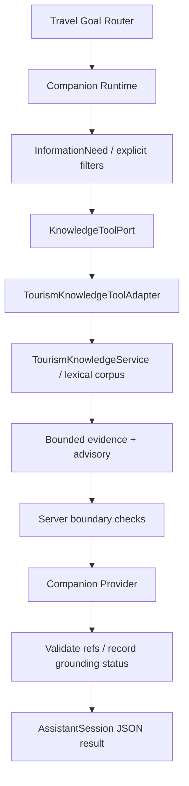

# Travel Companion Agent — Phase 2

Date: 2026-09-29. Evidence labels: VERIFIED（代码/断言），MEASURED（真实运行记录），INFERRED（设计判断）。本报告针对当前工作树；部署、Demo READY、Ledger Stage 2.2 完成均不属于本轮结论。

## 1. Merge / Repository State

VERIFIED：开始时主库 HEAD `5572849`，已有 60 个 tracked 修改和大量 untracked 工作；未 reset/clean/checkout、未提交用户既有工作，未改 Git index/HEAD。检查 `5023a28` 的完整新增文件 diff、parent `0fab288` 和目标路径后，使用 `git apply --check` 再 `git apply`，只引入 implementation commit 的 18 个新增文件。没有合并 snapshot parent 或整个分支，没有冲突。

Windows Git 自动转换 CRLF；标准化换行后，18 个文件与提交 blob 完全一致。本轮未修改 Phase A 原代码、fixture、测试及历史报告。Planning Graph/Context/Run repository、strict resolver、Revision service、route enrichment、Execution service 的前后 SHA256 相同。证据：`backend/evals/results/companion_phase2/integration_audit.json` 和 implementation-only patch。导入的 Phase A verification 是其旧快照测量，不是当前主工作树回归。

MEASURED：编码前新跑 Linux/Python 3.11/PostgreSQL 17 全量基线 **429 passed / 0 failed / 2 existing warnings，50.54s**；没有机械复用 Phase 1 数字。

## 2. Contract Mapping

| Companion contract | Tourism Knowledge contract | 规则 |
| --- | --- | --- |
| query / destination / knowledge_types | TourismKnowledgeRequest 同名字段 | destination 是显式查询过滤，不是正式地点解析 |
| max_results | top_k | 本轮最大 10，默认 5 |
| audience/season/experience tags | 同名 tuple filters | 明确传递，retriever 不推断 |
| KnowledgeToolResult evidence | KnowledgeHit.chunk | 截断正文到 2000 字，保留 document/chunk/source identity |
| KnowledgeAdvisory | RetrievalAdvisory | sufficient/live/decision/reasons/warnings/evidence_kind 全保留 |
| external_place_ref | chunk.place_id | 加 `tourism_corpus:` 域，不能作为 Activity/Planning ref |

七种 knowledge types 与 Phase A 完全对齐。新增字段都有默认值，Phase 1 saved JSON 仍可解析。`status=available` 只表示存在 evidence；`outcome` 和 advisory 决定能否用于回答。矛盾的 available/live/decision outcome 被 schema 拒绝。来源 authority 表示出处，不代表每个模型句子都被验证。

## 3. Adapter

`TourismKnowledgeToolAdapter` 只依赖两侧 public contracts 和 `TourismKnowledgeRetriever` Protocol。Graph 继续只依赖 KnowledgeToolPort，不 import BM25、repository 或排名实现。Adapter 使用 **lexical**、`include_fixtures=false`，映射 request，检查 returned query、metadata filters、fixture、有效期及 bounded identity，再构造带 provenance 的 evidence。

Composition root `companion_knowledge.py` 首次使用时将 7 个 reviewed documents ingest 到一个进程内 repository，再原子发布只读 service/adapter。Assistant service 默认注册；测试/其他 runtime 可继续显式注入 port。无需 embedding、向量库、DB migration 或 runtime 网络抓取。重启会重新 ingest，当前不是 production persistent repository。

## 4. InformationNeed → Retrieval

`companion_information.py` 负责可见、确定性的 need/filter 决策，未改 Router Goal taxonomy：历史/文化 → history_culture；当地生活/茶馆 → local_lifestyle；明确春夏秋冬 → seasonal_experience + season tag；父母/长辈 → audience_strategy + travel_strategy + senior；摄影推荐 → place_experience；目的地构成 → destination_profile。每轮最多一次 port 调用。

“父母”到 senior 是检索策略，不是用户年龄事实，记录在 filter_signals；负向“不带父母”排除该规则。目的地仅小词表显式提及加既有会话状态；无法声称是通用地理解析。谢谢、喜欢确认、保存建议原理由、显式 Planning turn 不调用 RAG。实时天气/营业/票价/交通/执行时长直接要求 live facts，不用稳定知识填补。

## 5. Grounding Flow

模型只接收 bounded KnowledgeEvidence 和 retrieval summary；证据正文不重复放进 summary。每份证据保留 knowledge ref、document/chunk IDs、source URL/name/type/authority、review/ingest/expiry、scope 和独立 external place ref。结果持久化 answer_evidence_refs、knowledge_evidence、retrieval summary 与 grounding status。可以从答案引用追踪到 chunk/document/source，前端仍显示文本。

模型有独立简短 grounding prompt：仅使用提供资料支持的事实、不包装模型记忆、不造引用、资料不足说限制、稳定资料不证明实时状态或原规划理由。配置缺失时用带 refs 的 extractive 摘要；live eval 则强制要求真实配置，禁止把 fallback 算作 real provider success。

## 6. Boundary Enforcement

Graph 在模型前检查 advisory：live_required → 缺实时工具；decision_context_required → 需要原决定记录，旅游背景不能代替；knowledge_insufficient → 不发布 grounded answer。实时问题在 InformationNeed 阶段即可 bypass 模型/RAG；上游漏判但 retriever advisory 识别时，仍拒绝使用背景 hits 回答。timing explanation 的 18 点等明确时间还要求 timing_conditions。

原建议理由来自保存的 Suggestion turn，引用沿其保存 evidence 追踪；原 formal rationale 仍依 Phase 1 的 accepted/current-version/validated-summary/exact-Activity/time 条件。缺记录返回 rationale_unavailable。RAG 的“傍晚体验”不会提升为原始 Planner reasoning。knowledge / suggestion / Revision / formal Activity namespaces 分开，现有 Ledger shadow/OPEN 权威不变。

## 7. Corpus

仅 `backend/app/knowledge_corpus/hangzhou_reviewed_v1.json`：7 份短释义，4 个真实官方/机构网页，目的地仅杭州。不是大规模抓取，不是 production coverage。审阅由本轮 Codex 对官方页面及网页索引内容完成，非独立人工事实审计。

| 文档 | 类型 | 来源 / 审阅范围 |
| --- | --- | --- |
| hz-westlake-history / profile / experience | history_culture / destination_profile / place_experience | [UNESCO 西湖文化景观](https://whc.unesco.org/en/list/1334)：历史概述、山水/堤岛/寺塔构成；摄影方向明确是依据景观描述的 curator 推断 |
| hz-tea-lifestyle | local_lifestyle | [杭州文旅茶馆文章](https://wgly.hangzhou.gov.cn/art/2023/1/17/art_1229505585_58944038.html)：喝茶/观景/慢生活主题；直接 fetch 超时，审阅搜索返回正文 |
| hz-autumn-osmanthus | seasonal_experience, autumn | [杭州政协网赏桂文章](https://www.hzzx.gov.cn/cshz/content/2026-09/24/content_9315838.htm)：只提取秋季赏桂文化，不保留 2026 活动或花况 |
| hz-senior-strategy / slow-travel-strategy | audience_strategy / travel_strategy, senior | [政府门户老年旅游规范](https://www.beijing.gov.cn/zhengce/zhengcefagui/201905/t20190522_58955.html)：舒缓节奏、活动强度及休息的一般原则；不是杭州具体设施/个人健康适宜性证明 |

未保留电话、价格、经营时段、预约、交通班次、天气、具体花期/开花进度或年度活动。当前主题按 stable 存储；adapter 同时支持 semi_stable + expiry，expired hits 会拒绝。重用旧网页只证明这些文化/一般原则主题，不能用于当前运营事实。

## 8. Tool Precision

MEASURED offline tool-selection eval：20 条，人工声明 expected need，15 required/15 called，5 not-required/0 called；TP=15、FP=0、FN=0，precision=1.0、recall=1.0。真实 curated ingestion/BM25/adapter，generation 是 controlled fake（14 calls），real provider=0。不能以此代替 live answering。

Corpus 未覆盖的春季和苏州仍会调用知识 port，再分别返回 no_results/unsupported_query；这些不是 tool-selection false positives。父母秋季 tags 在上层产生；adapter 的单独测试确认 query 自身含这些词也不会隐式补 filters。

## 9. Grounding Safety

结构化 draft refs 与正文中 `knowledge_…` refs 必须属于真实 supplied refs；invalid refs 抛 CompanionContractError，经 Assistant 返回结构校验错误，不静默删引用后继续发布。缺 citation 的有资料回答不会作为 grounded factual answer发布；推荐中无证据的部分仍是 unverified proposal。

grounding_status 区分 citations_validated、insufficient_evidence、live_verification_required、decision_context_required、unverified_proposal 等。citations_validated 只表示引用集合校验，grounding_limitations 明确 `claim_entailment_not_verified`。控制性 bad case 故意输出“西湖在公元9999年形成”并引用真实 ref：引用校验仍通过，测试记录其不受源文支持，绝不将此称为事实正确。完整 claim/evidence verification 是后续工作。

No results、unsupported query、retriever unavailable、knowledge insufficient、live verification required 各有 outcome/gap 与不同降级文案；provider/adapter错误不携带 upstream 私密正文。故障 payload 的错误目的地、fixture、过期和 oversized identity 会被拒绝。

真实 parents case 暴露了通用长辈规范被推成“杭州适合带父母”的问题。本轮增加 `applicability=general_strategy/destination_specific/unspecified`，prompt 明确适用范围，并在只有 general_strategy 时对目的地适宜性断言增加窄规则：整体替换 draft 为源文一般原则与缺证据说明，删除建议、记录 knowledge_insufficient。复测实际触发了服务器降级。这只是该类措辞的 backstop，不是通用 claim verifier；最终 result 仍可为 citations_validated，因为它只表示引用有效，回答状态则为 needs_information。

## 10. Planning Handoff Safety

RAG-backed建议 → 第二个喜欢 → 明确安排第二天下午，仍以稳定 Suggestion ref 构造 Brief；兴趣不自动变 must-do。Suggestion 只有 raw mention identity，不接受 corpus place ref 作为 Activity ID。原 PlanRun/worker/strict resolver/Planner/validator/Revision 生命周期与显式 accept/reject 保留。

Planning ToolRouter history 去掉 Companion metadata / 原始 corpus evidence，显式 Brief 单独提供来源绑定的需求；普通 user/assistant history 和旧 answered-Run兼容路径保留。真实 SQL 集成确认前三轮无正式 mutation，只有明确 Planning turn 新建一个 Run；Brief 不直接写入正式活动，也不注入新的 Graph 硬约束。

## 11. Files Changed

Import：5023a28 的 18 个独立新增文件（清单见 audit/Phase A报告）。本轮新增：`tourism_knowledge_adapter.py`、`companion_knowledge.py`、`companion_information.py`、7-doc curated JSON、`test_companion_knowledge.py`、`evals/companion_phase2/{__init__,run}.py`、Phase 2 artifacts/report。

本轮修改：`companion_contracts.py`、`companion_graph.py`、`companion_provider.py`、`assistant_service.py`；Web optional metadata types 与既有 Companion fixture；Android既有 ignoreUnknownKeys fixture。文档更新 architecture / PROJECT_STATE / LATEST_HANDOFF。无 Router taxonomy改动、production Android DTO改动、新复杂 Citation UI、新依赖或 migration。

## 12. Deterministic Tests

覆盖真实 corpus ingest/retrieval/adapter/provider context、四个主要 knowledge types与tags、来源JSON、minimal SQL、formal-state snapshots、grounded建议 reload/Explanation/Brief、live/model bypass、advisory backstop、distinct failure states、invalid结构化/正文refs、missing citation、故障provenance、无隐式metadata推断及citation不等于entailment。保留原 Phase 1测试。

初次 focused **137 passed / 2 failed**，暴露了新不可用文案与旧断言不一致、provider usage instrumentation 对最小 mock Settings 属性的假设。恢复兼容文案和optional instrumentation 后，**162 passed**，原测试未删除/放宽。后续 added edge contracts 的最终测量见 Full Regression。

## 13. RAG Benchmark

MEASURED curated lexical benchmark **8/8**：七个类型的标注文档在 top 3 中，另一个明确 spring tag 空结果。使用真实短 corpus，无模型/embedding，development cases、非 holdout。

Phase A独立 synthetic benchmark重新执行：lexical/semantic fake/hybrid fake 各27 cases；Recall@3 分别12/12、13/13、13/13，category/filter/source/boundary/empty指标均达到其fixture断言。semantic/hybrid用人工概念embedding，不能声称真实语义检索质量。原results.json只作历史证据，新的测量在companion_phase2/phase_a_benchmark.json。

## 14. Real Companion Eval

MEASURED：使用当前配置 **GLM / glm-5.3-flash / reasoning=max / timeout=180s**，Docker 内调用实际 ModelCompanionProvider，真实 corpus/retriever/adapter，无 fake generation。独立评测不连接 DB、不提供 mutation tools，正式状态安全由 PostgreSQL tests 证明，不能从此批次推出生产 mutation 结果。

| 批次 | 表达 / 实际模型完成 | 知识调用 | 引用 / 边界检查 | 用量 / 延迟 |
| --- | --- | --- | --- | --- |
| 主批次 | 20 条 / 14 次，fake 0，error 0 | required 15 / called 15；不需要 5 / called 0；precision/recall 1.0 | invalid refs 0；营业/天气未给实时答案；没有伪造原规划理由 | 43,034 tokens（prompt 21,350 / completion 21,684）；14 model turns 中位 43.309s，6.696–87.907s |
| 修复后定向复测 | 2 个重复 case / 1 次，fake 0，error 0 | parents 1，original_reason 0 | parents 安全 extractive 降级；18点同时标记 timing_conditions/live 与 rationale 缺失 | 5,355 tokens；parents 100.597s；原理由确定性返回 0.011s |

20 个表达的原始 goal、need、request、document/chunk refs、answer、引用、模型使用量与延迟都保存在 `live_eval.json`。定向复测是同一案例的修复后测量，不增加独立表达数。主批次开始于 applicability/timing 修复前，最终代码行为以 `live_followup.json` 及新增 regression 为证。

初次 Windows 调用配置中的 Docker proxy host 出现 transport failure：eval 6 次逻辑尝试、诊断 1 次，均无完成响应/usage。转到 Docker 后成功；这些失败单独保留在 `live_eval_initial.json` / `live_transport_diagnostic.json`，不计入回答质量样本。SDK wire retries 未测，不声称逻辑 attempt 等于 HTTP request 总数。

VERIFIED/INFERRED：本轮 Codex 对全部 20 个可见结果按提供的源文做有限读者审查，记录在 `live_answer_review.json`，非盲测/独立人工审计，不报“20/20 完全 grounded”。主要观察：

- 历史/文化/构成要素：核心答案可追踪 UNESCO 源文，主动说明朝代、人物细节不足。茶生活/赏桂只描述资料主题，未证明店铺现状、花况或天气。
- **真实 bad case 已修复并复测**：parents 原答案开头断言杭州适合带父母，通用规范不支持；最终服务器整体替换为一般原则和局限。不能把这次 guard 成功视为 prompt 或全文 entailment 已解决。
- **保留的 need recall bad case**：“西湖形成于什么精确年份？”错分 travel_strategy，得到 no_results；未造年份，但模型加入无来源的地质概括，insufficient_evidence 标签不能验证该句。后续需要历史语义覆盖与缺资料回答约束。
- autumn_culture 将 curated 文档标题当作转载文章标题；核心主题有来源，标题归属未经核实。茶馆半日、安静体验及长辈方案比较等属于模型建议或推断，不能全部计为检索事实。
- 摄影只生成一个有证据的西湖建议，明确不补其他地点。因此“第二个不错”正确澄清未知序号，零 RAG/模型；这不是第二建议身份解析成功的 live 证据。多建议 ordinal/Explanation/Brief 的成功证据来自 controlled provider 与真实 SQL 集成。
- 原理由主批次没有伪造理由，但未标记18点实时条件；最终 need 已修复，定向复测同时保留 rationale_unavailable 与 live_fact_unavailable。

## 15. Full Regression

MEASURED 最终 Linux / Python 3.11 / PostgreSQL 17：**542 passed / 0 failed / 0 skipped / 2 existing warnings，52.27s**。429 的新测量基线之上新增 113 collected cases：Phase A 导入 82、本轮 Companion integration 31。两条 warning 是既有 Starlette 422 弃用提示。`final.xml` / `linux_postgresql_final.log` 为当前测量，原 snapshot 的失败不可代替当前结果。

Web：**101 passed / 18 files，19.57s**；TypeScript typecheck PASS、production build PASS（5.91s），三处既有 React act warning。Android：**35 tests / 0 failures / 0 errors / 0 skipped**，unit Gradle build PASS（18s）。原测试保留。

Phase 1 Runtime eval **21/21**（fake 3 / real 0），Goal corpus **60/60 runtime/goal**、Error A=0/35、B=0/20（provider 0）。这些是 development fixtures，不是通用或盲测准确率。完整机器汇总：`backend/evals/results/companion_phase2/regression_20260929.json`。

最终全量回归覆盖最后的 applicability/prompt/guard/timing 与 Planning history sanitize 业务代码；之后只增加 eval 的 repeatable `--case-id` CLI、归档与文档，CLI 已实际完成两条定向 live case。最终审计确认七个受保护 Planning/Execution 文件 hash 不变，18 个 Phase A 文件标准化换行后仍与 implementation commit 一致，Git HEAD/index 未被本轮改变。

无部署、无真实 Demo reset、未做浏览器演练或Android真机验收；Demo NOT READY、Ledger Stage 2.2 OPEN保持。Web/Android collected 数未增长，只更新optional metadata fixture。

## 16. Limitations

- 小型单城市语料，不覆盖杭州所有地点、历史细节或季节；一般长辈原则不是杭州设施事实。来源页转载 authority也不提升为当前权威live fact。
- Chinese deterministic need/filter vocabulary有限，parents→senior不是年龄判断；未知城市/混合目的地问题仍可能需要更多coverage/澄清。
- BM25正分hit与advisory sufficient只是scope backstop，不能证明query每个子问题都被支持；similarity不是factual correctness。
- Citation membership不是claim entailment，已保留控制性unsupported-claim bad case；live读者评审也不是独立或盲测。
- 真实形成年份 query 的 need recall、缺资料时模型概括、文章标题 attribution 仍有不足；窄适宜性 guard 不覆盖所有同义措辞或混合证据。
- JSON identity重建/O(n)及兴趣撤销、自动summary、长期Memory仍是Phase 1既有限制。Corpus内存加载无production persistence/embedding。
- 没有 Fact Resolver、Companion weather/实时AMap、Knowledge Agent或新增正式 mutation 权限。

## 17. Recommended Next Phase

INFERRED：选择 **Companion Knowledge Reliability**。真实评测已有通用规范→目的地适宜性的越界、need 类型漏识别、缺证据概括与标题归属问题；接入更多实时源之前，应先验证当前 evidence 是否支持用户实际问题。

建议下一小阶段：建立独立 holdout 与逐句 claim/source 标注；区分事实、建议、curator 推断；改进历史/形成类 need recall；在 no_results/insufficient 时限制未支持的事实扩展；验证通用来源的适用范围与文章 attribution。扩展少量可审阅语料后重复真实批次与同样的 mutation/handoff 回归，报告有效回答覆盖率及拒答质量，不以 citation validity 代替正确性。

Travel Fact & Evidence / Fact Resolver 随后接实时工具；本轮已能明确降级，无需通过当前 RAG 猜运营事实。Ledger Stage 2.2 与 Demo rehearsal 仍由各自 Exit Gate 决定。
