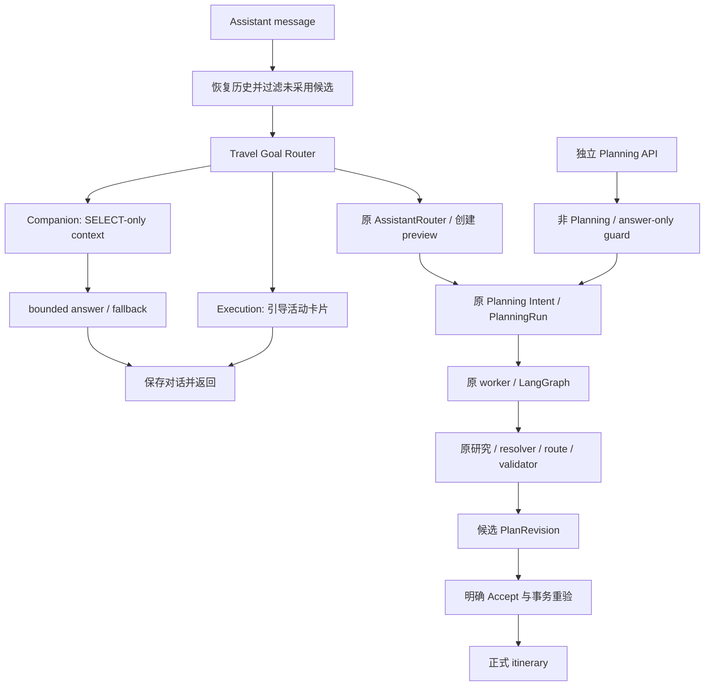

# RoamSync Travel Goal Routing — Phase 0 工程报告

日期：2026-09-29。实际工作仓库：`E:\Study\RoamSync`，起点 HEAD：`5572849`。
证据口径：VERIFIED 表示代码/测试直接检查；MEASURED 表示本轮实际运行；INFERRED 表示设计判断。
仓库开始时已有大量未提交改动和未跟踪源码；本轮在该真实工作树上增量修改，没有把既有 diff 算成本轮工作，没有提交、重置或覆盖其他开发成果。

## 1. Current Architecture Findings

编码前已读取真实入口、数据库模型、Graph/runtime、测试与当前 diff；handoff 仅作为上下文。

| 审计问题 | 原实现与真实代码位置 |
| --- | --- |
| 1. 第一个理解消息的模块 | `assistant_routes.py` 的 message endpoint → `assistant_service.send_message` → `AssistantRouter.decide`。首层是模型选择 ToolDecision，并非高层 TravelGoal。 |
| 2. Planning Intent 职责 | `planning_intent_service.py` 负责规则/可选语义草稿、实体 grounding、范围、缺失字段、多 operation、风险与 answer/clarify/plan_preview/reject policy。它不是独立 Companion runtime。 |
| 3. Intent 定义 | `schemas.py` 的 PlanningIntentType、IntentPrimary、IntentOperationType；包括 create/replan/add/remove/replace/reorder/adjust_budget/weather_replan。保留原分类。 |
| 4. Clarification | Assistant 创建旅行前确定性检查目的地与时间窗；Graph 的 clarification node 对已建 Run 中缺失/歧义实体 interrupt，最多两轮。两种状态不能混用。 |
| 5. PlanningRun 创建 | Assistant plan_trip/query_trip；create/reuse 确认后初始规划；直接 planning API；结构化 navigation/experience recovery。原 repository 接受 answer-only route。 |
| 6. 回答与 Revision | ToolDecision.reply 是调度回执；问答也创建 Run，Graph answer_node 持久化 response_text/status=answered；Preview 才生成 Revision；Accept 才改正式行程。Web/Android 用 Run.response_text 替换调度回执。 |
| 7. Execution | `main.py` → `trip_execution_service.py` 独立动作 API。extend_stay/leave_early 产生幂等执行事实，Web ActivityExperienceCard 提供按钮；原聊天没有动作执行桥接。 |
| 8. Recovery | `navigation/observation_ingestion.py` 接收有版本/序列的 observation，持久化 detector/disruption，`_ensure_recovery_planning_run` 去重入队。`experience_replanning_service.py` 以事实 fingerprint 触发 recovery。 |
| 9. 可复用 classification | ToolDecision 是工具选择；SemanticIntentDraft/IntentPolicyDecision 是 Planning 范围内语义与 policy；planning_goals.py 是规划约束/Goal 校验。均不等同于旅行目的路由。 |
| 10. 最小侵入点 | send_message 收集历史后、Planning Context 与 AssistantRouter 之前。无需迁移 Graph。 |
| 11. 稳定边界 | worker lease/checkpoint、strict short-ref resolver、研究/route enrichment、validator、Revision accept/reject、Decision Memory 的 trip/day/version 隔离、Ledger shadow 与确定性 recovery 均保留。 |
| 12. 可扩展测试 | assistant_tools/assistant_answers；conversation/destination_research；planning_graph/planner/entity_resolution；Ledger/Memory；navigation/experience/trip_execution；Web AiPlannerPanel 和 Android PlanningWorkflow。 |

研究事实链也已审计：Graph 仅在需要地点发现时进入 `destination_research.py`，通过已有 AMap POI 和 Tavily/外部事实形成候选；candidate_route_service 在身份解析后补路线。`external_facts.py` 已有 Open-Meteo 与 Tavily 适配器。它们继续属于现有 Planning 链，未授权给临时 Companion。

## 2. Important Differences From Assumptions

- 系统原本就有 read-only answer policy，但回答占用 PlanningRun；“没有 Revision”不等于满足本轮“没有 Run”。因此修改新建任务契约，同时保留历史 answer Graph。
- Assistant 创建 Trip 与 Planning Revision 接受是两个写入生命周期。创建/改期/复用仍须独立 preview 确认，不能全部归入 Revision。
- Execution 已有独立、幂等 API 和恢复链；不需要包装为新 Agent。
- 现有 Planning 已有天气/搜索适配器；尚未拥有共享 TravelFact/ResolvedFact 权威层，也没有 Companion 检索上下文。
- planning_goals.py 已承担正式规划 Goal，不应被高层 TravelGoal 替代。
- 原有 Decision Ledger 处于 shadow、Stage 2.2 OPEN；本轮不把聊天历史当作已验证 Decision Rationale。

## 3. Design Decision

采用确定性、高层 Travel Goal Router。选择依据：风险最高的是把聊天提升为 mutation；Phase 0 优先让没有明确授权的消息留在 Companion，避免新增一个模型调用及对稳定 Planning Graph 的依赖。此选择是 INFERRED，不能视为普遍自然语言理解能力证明。

放在 `send_message` 中，历史恢复/拒绝候选过滤后，Planning Context/ToolDecision 前。Companion/Execution 结构性提前返回，Planning 继续走旧子系统。另在 create_planning_run 增加入口 guard，防止直接 API 绕过。

规则按执行动作、明确规划/修改、已授权的字段追答、各类 Companion 目标判断。问句、否定、假设、探索与偏好表达避免被地点/天数关键词提升。信息问句后即使出现 Planning 词语，也不继承写权限。混合消息中独立明确的调整子句可进入 Planning。

## 4. New Contracts

`TravelGoalType`：travel_chat、destination_exploration、destination_discovery、travel_advice、comparison、recommendation、explanation、trip_planning、trip_modification、replan、trip_execution。

`TravelGoalRouting` 包含 goal_type、confidence、target_runtime、mutation_requested、trip_context_required、knowledge_required、live_fact_likely_required、referenced_entities、referenced_previous_decision、clarification_needed、signals。

运行时为 companion/planning/execution。Schema 拒绝 goal/runtime 不一致及非 Planning 的 itinerary mutation_requested=true。Execution 中该字段为 false：它描述正式行程 mutation，不表示执行事实操作。

confidence 是规则优先级分值，未做概率校准。quoted referenced_entities 是原始提及，不是数据库身份或候选 ref；Planner resolver 权威保持不变。knowledge/live_fact 是需求提示，不表示实际工具调用。signals 只有短分类标签，不保存长推理。

`CompanionAnswer` 只允许 answer 字符串，extra=forbid；复用现有模型 client/structured JSON envelope/error translation，不传数据库或 tools。无模型配置时有安全的中文 fallback。

路由结果写入已有 `AssistantSession.messages[].goal_routing` JSON；顶层 session API 不变。没有新表、列或 migration。直接 planning API 对明确 Companion/Execution 新请求返回现有 422 错误 envelope，route 分别为 companion/execution；answer-only policy 也无法 INSERT。

## 5. Routing Flow

结构化 disruption/experience facts → 原 recovery service → 原 Run/Graph。guard 不将这些确定性事实重新分类为聊天；它们原有 trip/version/active/dedup 约束继续适用。

## 6. Mutation Safety

正式原则：

> Never escalate a conversational, exploratory, informational, recommendation, comparison, or explanation request into an itinerary mutation without explicit user intent.

- Companion responder 只有普通 context 与 routing 数据，没有 DB session、write tools、ToolDecision 或 Graph 调用权。提前 return 位于 prepare_action/create_planning_run 之前，响应文本不被解析成动作。
- Companion context 使用 get_day_plans 与直接 SELECT 偏好记录，避免 build_planning_context 的“缺偏好时补写”兼容行为。只保存 AssistantSession 对话状态。
- direct planning API 同时挡住明确 Companion/Execution 和 answer-only policy。未知低置信直接规划提交仍使用现有意图 gate，不由聊天授权；这是兼容既有 planning submissions 的明确限制。
- Suggestion 是聊天内容；Planning Decision 是通过校验的候选；Formal Mutation 仍由明确确认及既有确定性事务执行。Companion 所谓“已添加”文本没有任何写入效果。
- 安全测试遍历语料中全部 35 个 Companion 表达，故意注入错误文案“已把博物馆加进行程”，断言不调用 Planning router、Run/Revision 数量不增加、Trip.version 不变、正式 days API 不变，逐列比较 Trip/DayPlan/Activity/RouteLeg/TripExecution/ActivityExecution/TravelEvent。测试先建立真实执行记录，并移除旧 Trip 的偏好记录，确认读取也不补写。
- execution 聊天同样不改执行状态；实际“再待/离开”由原卡片 API 执行。

## 7. Clarification Behavior

“国庆想出去休息几天，但是不知道去哪”是 destination_discovery，直接进入 Companion，不运行创建 blocker、不创建 Run、不生成 planning interrupt。

“帮我安排杭州三日游”进入 Planning；旧 Assistant 创建时间窗检查及 Graph 的 clarification interrupt 保持。日期/人数等字段追答仅在最近存在明确 Planning 用户请求或待确认 creation action 时继续 Planning；新问题、目的地发现和打招呼不能继承权限。最近 rejected/failed/cancelled 候选不授予追答权限。

没有历史的“那呢？”可标记 clarification_needed，但这是对话澄清，不是 Planning required-field error。Phase 0 未新增 Companion interrupt lifecycle。

## 8. Multi-turn Behavior

Scenario A：杭州适合我吗 → 偏好描述 → 那就去杭州吧，连续 Companion；帮我安排三天，才切到 Planning。

Scenario B：西湖历史 → 为什么之前安排晚上，保持 Companion explanation；那改成上午，切 Planning mutation。

两条序列均有 classifier 测试与真实 send_message/数据库测试：只有末轮创建一个 Run，前面各轮为零。Planning tool context 收到已保存 Companion 回答，因此“按第二个建议，但保留餐厅”仍能由原 ToolDecision 扩展为完整规划请求；建议本身不提升为已接受 Decision。另有偏好→人数追答、planning 日期追答→新问题、pending creation→聊天的反例。

## 9. Files Changed

以下只列本轮增量，不代表文件整个 git diff 都由本轮产生。

| 文件 | 本轮变化 |
| --- | --- |
| backend/app/schemas.py | 高层 taxonomy、Routing schema 与权限一致性校验 |
| backend/app/travel_goal_router.py | 新增规则路由、短 signals、多轮授权边界 |
| backend/app/assistant_service.py | 路由提前、SELECT-only Companion context、bounded answer/fallback、Execution 提示、session metadata |
| backend/app/planning_run_repository.py | 新 Run 的非 Planning 与 answer-only guard，保留结构化 recovery |
| backend/evals/travel_goal_cases.py | 60 条自然表达 corpus |
| backend/evals/run_travel_goal_eval.py | 可重跑离线评估，分别统计 Error A/B |
| backend/evals/results/travel_goal_routing/ | 分类结果 JSON、回归证据与最终 Linux 日志 |
| backend/tests/test_travel_goal_routing.py | 10 个新增路由/contract/多轮/runtime/安全/API/provider 测试 |
| backend/tests/test_assistant_answers.py | 9 个问答创建测试改为 422；历史 answer Run compatibility fixture |
| backend/tests/test_assistant_tools.py | 旧 query 问答测试改为 Companion，保留后续明确 Planning 的原历史展开断言 |
| web/src/domain/types.ts | 可选 per-turn goal_routing 类型 |
| web/src/components/AiPlannerPanel.test.tsx | 新增无 Run 的 Companion 回答展示与无规划调用测试 |
| android/app/src/test/java/com/roamsync/app/ui/PlanningWorkflowTest.kt | 既有 DTO compatibility 测试加入新 metadata，生产 DTO 无需变更 |
| docs/AGENT_ARCHITECTURE.md | 正式边界、不隐式 mutation、兼容性与新建 Run 行为 |
| docs/handoff/PROJECT_STATE.md、LATEST_HANDOFF.md | 主请求路径与完成状态同步 |
| 本报告 | 审计、决策、证据、限制与下一阶段 |

Graph、worker、resolver、Decision Memory/Ledger、research、validator、Revision accept/reject、execution/navigation 服务及 seed 没有本轮重构。

## 10. Tests

最终测试数字与命令记录于 `backend/evals/results/travel_goal_routing/regression_20260929.json`，最终完整 Linux 输出为同目录 `linux_postgresql_final.log`。

- MEASURED 修改前：本轮实际工作树、Linux Python 3.11/PostgreSQL 17、干净测试库迁移到 head；395 passed、0 failed、2 warnings，46.80s。不是引用旧 handoff 数字。
- MEASURED 最终 Linux/PostgreSQL：405 passed、0 failed、2 existing warnings，45.83s；新增 backend 10 个 collected tests，原 395 个测试仍保留，其中问答行为断言按新契约更新。覆盖 create/replan/add/replace/reject→next/clarification/resolver/schema/validator/revisions/自动恢复。两项 warning 均为原 test_planner 中 HTTP_422_UNPROCESSABLE_ENTITY 的 Starlette deprecation。
- MEASURED Web：101 passed、0 failed（18 文件）；新增 1 项，typecheck 与 production build PASS。已有 ActivityExperienceCard 的三处 React act stderr 仍出现。
- MEASURED Android：`:app:testDebugUnitTest` BUILD SUCCESSFUL，XML 合计 35 tests、0 failures、0 skipped。未声称真机或 APK 验证。
- MEASURED corpus：60/60 runtime，60/60 goal；35 Companion、20 Planning、5 Execution；Error A=0/35，Error B=0/20。mode=offline_deterministic_rules，provider_calls=0。不是独立盲测、实时 provider 测试或端到端建议质量评测。
- 首次有效修改后全套：400 passed、2 failed、2 warnings；失败来自“还是两天”追答与“希望行程中包含地点”被拦。已修复原兼容表达，没有删除这些回归测试。另一次混用 runner 的测试数据库竞争结果被判为无效，未作为基线/最终结果。

可复现：仓库根 `docker compose -f compose.test.yaml build api-test`；独占干净 postgres-test；测试容器执行 `uv run --no-sync alembic upgrade head && uv run --no-sync pytest`。Backend 目录运行 `python -m evals.run_travel_goal_eval --output evals/results/travel_goal_routing/phase0_20260929.json`。Web `pnpm test`、`pnpm typecheck`、`pnpm build`；Android `gradlew.bat :app:testDebugUnitTest --console=plain`。

## 11. Risks / Open Questions

- 规则以当前中文场景为中心，未识别的明确 Planning 可能留在 Companion；confidence 未校准。60 条开发 corpus 不证明开放表达、其他语言或对抗表达准确率，应维护独立 holdout/线上 shadow bad cases。
- 临时 Companion 没有 RAG、live facts 或持久化 Recommendation Rationale。缺实时信息或原理由时只能说明无法核实；建议质量未进行 live provider 验收。错误文本无法写入，但文本真实性仍依赖 bounded prompt/后续 evidence gate。
- 当前复用模型配置和简化正式行程/偏好/历史；未建完整 CompanionContext、Suggestion store、长期 preference memory 或 PlanningBrief。JSON 路由日志不是持久化偏好学习。
- 单条消息同时含 execution 和 planning 时执行提示优先，不执行任何动作；独立多目标 handoff 是未来设计点。
- Companion 期间保留原 pending_action；确认按钮仍独立授权先前 preview，不会把当前聊天文本用于确认。既有 pending Run 继续工作，本轮没有自动取消它；客户端仍采用原 working-run 交互约束。
- direct planning API 的问答新建行为是有意的契约变化；外部旧客户端应迁移到 assistant message。历史 Run/Checkpoint/Revision 不改写，无 migration。
- 本轮没有部署/真实旅游数据重放；只操作隔离测试数据库，既有 Demo rehearsal NOT READY 与 Ledger Stage 2.2 OPEN 不因 Phase 0 自动关闭。

## 12. Recommended Next Phase

Travel Companion Agent Phase 1 — Independent Runtime & Companion Context。

先建立只读 CompanionContext 与有来源的 Suggestion/Explanation 契约，明确历史 user decision、建议、已验证 Planning rationale 的身份；设计显式 PlanningBrief handoff 与缺信息对话状态，再扩展 bounded knowledge retrieval。将已有 AMap/Tavily/Open-Meteo 事实适配器经统一 evidence/freshness 权威接口共享，避免直接把实时猜测当成知识 RAG 输出。

Phase 1 验收继续以无 mutation 权限为前提：独立 holdout 的 Error A/B、多轮真实 runtime、事实不可用与缺 rationale 的安全回答；再做真实 provider 对话质量评测。完整 RAG、Fact Resolver、长期偏好记忆按独立阶段推进。
