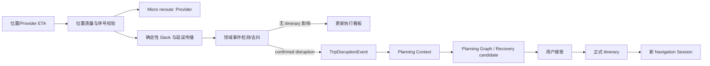

# RoamSync 导航与实时行程执行设计

日期：2026-09-15。状态：设计完成；首个纯确定性 Slack 核心已开始编码。本文件中的 `现状` 均来自当前工作树；`建议` 尚未全部实现。

## 1. 现有代码结构理解

RoamSync 已经有一条明确的正式计划保护链：`PlanningRun` 保存正式旅行的基准版本，Worker 领取任务并运行 LangGraph，图构建 `planning-context`、生成 `CandidatePlanSnapshot`、补齐 `CandidateRouteLeg`、确定性校验，最后持久化 `PlanRevision`。用户接受后，`accept_plan_revision()` 在事务内重新校验并写入 `Activity` 和 `RouteLeg`。模型没有直接写正式行程的路径。

现有路线分两类：`RouteLeg` 是正式日计划中相邻活动的静态路线快照；`CandidateRouteLeg` 是候选方案的可审计路线证据。`maps_service.resolve_route_result()` 通过高德路线 REST API 和 `RouteCache` 取得距离、时长、几何和备选路线。`recalculate_day_route()` 会删除正式 `RouteLeg`，并会为未锁定活动顺延时间，因此不能用于每次实时 ETA 更新。

`TripExecution`、`ActivityExecution`、`TravelEvent` 保存人工开始、到达、完成、跳过和人工动态重规划事件。`TripExecutionService.request_dynamic_replan()` 已能把事件变成一个 `replan` run；这是正确的确认链入口，但它的输入只有自由文本 trigger/details，且要求旧式 `TripExecution` 已启动。新版 Web 直接编辑活动状态，未暴露整趟 execution 控制；Android 也以路线展示和外部高德跳转为主。因此“正式计划—实际执行”在当前 Web 中存在断层。

LangGraph 的复用边界是正确的：它适合从已经确认会影响计划的 disruption 生成候选并等待用户决定；它不适合处理逐秒 GPS、偏航和地图 reroute。现有 `candidate_schedule.repair_route_schedule()` 已是一个有价值的先例：先用确定性代码修复可修复的时间冲突，再决定是否需要模型补充。

前端是 React 19/Vite Web 工作台加 Kotlin/Jetpack Compose Android 客户端，并非单一 Web 项目。Web `MapCanvas` 使用高德 JS API 只绘制正式路线和标记，定位按钮尚未接 `navigator.geolocation`。Android `RouteMap` 通过 WebView 装载高德底图，已经能打开高德 marker URI，但没有定位权限、后台服务或 turn-by-turn SDK。

## 2. 产品边界与 Provider 选择

导航不是 RoamSync 重做地图。Routing/Navigation Provider 负责“怎么走”：路线、距离、ETA、实时交通、必要的匹配/偏航状态和外部导航链接。RoamSync 负责“原计划还是否可行”：执行进度、Slack、影响传播、disruption、候选恢复方案和用户确认。

当前可选方案如下。

| 方案 | 优点 | 代价 | 建议 |
| --- | --- | --- | --- |
| 直接继续调用 `maps_service` / 高德函数 | 改动最少 | 规划缓存、实时路由和业务判断混在一起，后续无法适配 Google/Apple | 不采用 |
| 在业务层定义最小 `RoutingProvider` 协议，首个实现仍为 AMap | 复用已有 Key、POI、路线和 Web 地图；隔离坐标与供应商 DTO | 要新增 adapter 和 realtime cache | 推荐 MVP |
| 直接上高德完整导航 SDK | Android turn-by-turn 能力强 | Web 无法复用，权限和后台服务复杂，超出 MVP | Android 后续阶段 |
| Google/Apple/多 Provider 同时接入 | 海外体验更好 | 授权、计费、坐标、功能集不一致 | 接口稳定后逐个加入 |

因此第一阶段采用“接口先行、AMap 为唯一实现”的路线。接口暂分为 `RoutingProvider`（一次路线/ETA/几何）和可选 `NavigationProvider`（匹配、偏航或深链能力）。不要为了接口数量漂亮强行要求每个 Provider 支持实时 turn-by-turn；不具备能力时返回 capability，而不是伪造状态。高德坐标采用 GCJ-02；Google/Apple 和设备通常为 WGS84，转换必须封装在 Provider/coordinate adapter 内，数据库每个坐标要带 CRS，业务层不得默默混用。

## 3. 建议模块划分

`trip_execution_service.py` 继续拥有执行生命周期、人工完成/跳过和已确认 disruption 入队；不把 GPS 解析、地图请求或 Slack 算法塞进去。它会作为用例协调层调用新模块。

建议新增：

| 模块 | 责任 | 为什么 |
| --- | --- | --- |
| `navigation/providers.py`、`navigation/amap_provider.py` | Provider 协议、DTO、坐标和实时路由 adapter | 隔离高德/Google/Apple 差异，保护业务模型 |
| `navigation/session_service.py` | 创建/读取 session、route revision、位置更新序号、过期响应拒绝 | session 是短生命周期执行事实，不是 itinerary 编辑 |
| `navigation/delay_impact.py` | ETA→Slack→下游影响传播 | 可重复、可测试，不需要 LLM |
| `navigation/event_detector.py`（可先与核心同模块） | 偏航、ETA、时间窗、到达等原始事实转领域事件 | 防止每次定位直接启动 Agent |
| `navigation/disruption_service.py` | 去重、冷却、幂等、创建 `TripDisruptionEvent` 和 replan | 解决连续定位与并发 run 的竞态 |
| `recovery_planner.py` | 先枚举确定性恢复策略，再决定是否调用 Planning Graph | 恢复方案需有可比较的时间/费用/扰动结果 |

现有可复用模块：`build_planning_context()` 应增加“当前执行投影、已确认 disruption、受保护已完成活动”的只读部分；`create_planning_run()`、Worker、Planning Graph、Candidate/Revision/accept 服务继续承接 macro replan；`validate_candidate_plan()` 和 `CandidateRouteLeg` 继续担任候选的硬约束与证据；`repair_route_schedule()` 可成为“只移动可移动时间、不增删地点”的第一个确定性恢复策略。`maps_service` 中的 HTTP 错误分类、路线 DTO 解析、非实时缓存可迁移到 AMap adapter，但 `recalculate_day_route()` 不应被实时调用。

## 4. 领域模型与关系

正式 itinerary 是稳定的计划真源；Navigation Session 是针对一个当前 leg 的可替换运行时投影。一个 `TripExecution` 可有多个历史 session，但同一 trip execution 最多一个 `active/rerouting` session。Session 永远记录启动时 `itinerary_version` 和目标活动/路线引用；接受新 PlanRevision 后旧 session 标记 `superseded`，客户端不得继续用旧 route revision 覆盖新路线。

建议持久化 `NavigationSession`：

| 字段 | 含义 |
| --- | --- |
| `id`, `trip_id`, `trip_execution_id` | 所属执行；迁移期可为旧 execution 自动 ensure |
| `from_activity_id`, `to_activity_id`, `formal_route_leg_id` | 当前 itinerary leg 的稳定引用 |
| `origin`, `destination`, `coordinate_system`, `travel_mode` | 发起时的位置和目的地快照 |
| `planned_departure_at`, `planned_arrival_at` | 此 leg 的正式计划时间 |
| `current_eta`, `remaining_distance_meters`, `progress_ratio` | 当前 provider 预测，不改正式路线 |
| `status`, `provider`, `route_revision` | `created/active/rerouting/arrived/completed/failed/cancelled/superseded`；revision 单调递增 |
| `last_location_at`, `last_location_sequence`, `last_location` | 最新执行事实；保存精度须受隐私策略限制 |
| `itinerary_version`, `created_at`, `updated_at` | 防止旧响应覆盖新 itinerary |

`TripExecutionProgress` 不应另建第二个正式 itinerary。短期作为由现有 `TripExecution + ActivityExecution + NavigationSession` 组成的 read model，返回 current leg、实际状态、Slack、风险和下一步建议。待 Web/Android 都迁移后，再把旧 execution 语义统一；避免本期为“架构漂亮”复制一份活动状态。

建议单独增加 `TripDisruptionEvent`，而不扩大当前 `TravelEvent` 的泛用 JSON。它需要 `type`、`trip_execution_id`、`navigation_session_id`、`activity_id`、`detected_at`、事实 payload、impact snapshot、`dedup_key`、`status`（detected/ignored/planning/resolved）、`itinerary_version`、`planning_run_id`。这样能对同一个连续 ETA 风险去重、审计“为什么启动了 Agent”、安全地关联候选。旧 `TravelEvent` 保留记录人工执行历史。

原始 GPS 点不进入上述长期业务表。MVP 仅保存最后一次经最小化处理的位置、时间和精度，默认不留完整轨迹；若将来需要诊断轨迹，单独建立有 TTL、用户开关、加密和删除策略的 `LocationSample` 存储。

## 5. Slack、事件和状态流

每次有效的 ETA 更新都按剩余未完成 itinerary 做前向投影：当前 ETA 到下一活动；活动结束时间；到下一 leg 的交通；直至当天最后一个活动。再从每日结束时间和后续固定预约/班次向前计算每一活动允许的最晚开始时间。`slack = latest_feasible_start - projected_arrival`。它同时表达“迟到多少”“还剩多少缓冲”“影响是否向后传播”。营业时间、预约和班次在当前数据模型尚未结构化；接入后应作为硬窗口加入同一 backward pass，而不是交给模型猜测。

Micro Reroute：同一目的地的路径切换、道路拥堵和更快路线，只更新 session 的 current ETA/route revision 与地图。绝不调 LLM，绝不更改正式 itinerary。`OFF_ROUTE` 应由连续匹配失败、精度阈值和持续时间判断，例如至少三次高精度样本或 30 秒持续偏离；单点 GPS 漂移只记录观察值。

Macro Replan：`ETA_DELAYED` 先作为观察；只有它吃掉 Slack、影响固定窗口/每日结束/后续交通，或 `MISSED_TIME_WINDOW`、`DESTINATION_UNAVAILABLE` 这类不可行事实出现，才产生 disruption。`LEG_COMPLETED` 和到达是执行状态转换，通常不触发规划。推荐事件分类：

| 事件 | 默认行为 |
| --- | --- |
| `OFF_ROUTE` | Provider micro reroute；持续且 ETA/可达性恶化后再评估 |
| `ETA_DELAYED` | 更新看板；仅在连续超过阈值且 Slack 受损时升级 |
| `ARRIVAL_RISK` | 预警；负 Slack 或触及硬窗口时创建 disruption |
| `MISSED_TIME_WINDOW` | 直接创建 disruption |
| `LEG_COMPLETED` | 推进 execution，不调 Agent |
| `DESTINATION_UNAVAILABLE` | 直接创建 disruption，需有可验证来源/用户确认 |

Session 状态机：`created → active ↔ rerouting → arrived → completed`；网络/Provider 问题到 `failed`，用户停止到 `cancelled`，itinerary 被接受变更到 `superseded`。状态转移必须带 route revision 和 itinerary version 的 compare-and-set。Planning Run 仍复用现有 `queued → … → awaiting_confirmation → accepted/rejected` 状态机。

## 6. Recovery Planner

当 disruption 已确认，先运行确定性 recovery enumerator，产出可解释的候选输入，再让现有 Planner 在硬约束内完善。候选至少包括：更快交通方式保留全部活动；取消低优先级活动；压缩可压缩活动；局部调整顺序；保持原计划但明确风险。每个候选计算 projected arrival/end、总 delay、费用增量、取消/压缩活动、受影响后续固定活动、与原计划的变更数量，并生成原因。

这是 Agent 系统设计而不是普通 CRUD：代码决定什么事实能触发模型、给模型什么约束、候选如何验证和为何必须由用户接受。创建 session、保存最新 ETA、查询状态和渲染看板则是普通 API/CRUD；不能把后者误称为 Agent 能力。

无损 micro reroute 可静默更新 session。任何增删、重排、换交通造成费用/时间/活动变化的 recovery 都必须通过现有 `Candidate → user decision → transactional commit`。Planning Context 还应携带 disruption 的事实快照及 frozen completed/active activity，防止模型重写历史。

## 7. API 与前端交互建议

建议在 Provider 和 session service 实现后新增：

| API | 用途 |
| --- | --- |
| `POST /trips/{id}/navigation-sessions` | 用当前执行和正式 leg 创建 session，返回路线/ETA/版本 |
| `GET /navigation-sessions/{id}` | 恢复当前 session 和 progress projection |
| `POST /navigation-sessions/{id}/location-updates` | 带 `sequence`、时间、精度、坐标；返回 session、Slack、事件摘要；拒绝旧序号/version |
| `POST /navigation-sessions/{id}/reroute` | 显式刷新 Provider；同目的地，只更新 session |
| `GET /trips/{id}/execution-progress` | 执行 read model，不强迫 Web 使用旧 execution UI |
| `GET /trips/{id}/disruptions` | 解释已检测风险及关联 planning run |

Web MVP 仅在页面前台、用户主动授予位置后使用浏览器定位：显示当前位置、当前 leg、路线、距离/ETA、计划到达对比、Slack/风险、重新规划候选和 Google Maps/Apple Maps/高德深链。后台定位、可靠持续定位、系统级语音和完整 turn-by-turn 不承诺。Android 后续可用前台服务、精细/后台位置权限、系统通知和导航 SDK，但必须区分“授权时/仅此次/后台”，并允许随时停止和删除数据。

## 8. 工程异常与控制

- 位置隐私：显式 permission、按 session 最小化、默认不存轨迹、保留期限和删除入口；未来公开服务还需身份/对象授权，当前仓库尚无此边界。
- GPS 漂移：要求 accuracy、速度/时间合理性、连续样本确认和路线走廊；不要让单次点触发 OFF_ROUTE。
- 防抖：ETA 需越过阈值并持续一个窗口；同一 `dedup_key + itinerary_version` 在冷却期只保留最新影响快照，不重复启动 run。
- 竞态：位置更新按单调 `sequence`；Provider 请求记录 route revision；响应只在 session/version 仍匹配时写入。新 itinerary 接受后 session `superseded`。
- Planning 并发：disruption 创建与 run 创建同事务/行锁；每 session+itinerary version 只允许一个 active macro run。现有 worker 有 lease，但进一步实施时应增加 write fencing，避免失租 worker 写回。
- 成本与限流：实时 ETA cache 用短 TTL 且按 departure bucket/坐标网格；静态规划 `RouteCache` 不复用为实时 cache。Provider 429/配额、超时、网络失败都是可见降级状态。
- 弱网：显示最后可信 ETA 和时间戳；暂停自动 replan；允许外部地图 deep link；恢复后用新 sequence 刷新。不能把旧 Provider 结果称为实时。
- 国内外差异：Provider capability、地区、mode 支持、CRS、URL schema 都在 adapter，不出现在 Planning Graph。

## 9. 需改动的文件和新增文件

下一阶段会修改 `backend/app/database.py`、`schemas.py`、`main.py`、`trip_execution_service.py`、`planning_context.py`、`planning_run_repository.py` 和 migration；视真实 API 契约更新 `web/src/domain/types.ts`、`data/apiTripPlanningRepository.ts`、`components/MapCanvas.tsx`、`App.tsx`，以及 Android 的 Manifest、API DTO、ViewModel 和 RouteMap。Planning Graph 只在 planning context / recovery candidate 输入确定后作最小扩展，不能先把 GPS 节点塞入图。

已新增 `backend/app/navigation/delay_impact.py` 和对应单元测试。这是无 I/O 的基础层，尚未创建 session、数据库表、API 或 Provider adapter。

2026-09-15 实现更新：Phase 2A–2C 已完成为最小后端切片。`NavigationSession` 以 partial unique index 保证每个 `TripExecution` 最多一个 `active/rerouting` session；活动和 RouteLeg UUID 没有 FK，避免 revision 删除重建路线时破坏历史 session。`formal_route_leg_id` 仅记录创建证据。位置写入使用 `last_location_sequence < incoming_sequence AND itinerary_version = incoming_version` 的数据库 compare-and-set；路由刷新会先递增 `route_revision` 并释放事务，再在返回时按 version/revision compare-and-set。真实 AMap adapter、GPS 偏航、disruption 和 Planning Graph 仍未接入。

## 10. 测试策略与 MVP 顺序

1. **已开始：纯 Slack/传播测试。** 覆盖缓冲吸收 ETA、延误传播到预约、日末不可行和时区拒绝；不需要数据库或模型。
2. **Session 持久化/API。** migration、CAS route revision、旧位置拒绝、接受 itinerary 后 session superseded；使用 fake routing provider。
3. **确定性事件层。** GPS 抖动、冷却/去重、同一 disruption 只建一个 run、micro reroute 不创建 PlanRevision。
4. **Planning integration。** disruption context、确定性 recovery 枚举、候选指标和原有审批/接受回归；验证 completed/active 活动不变。
5. **Web 前台 MVP。** permission、位置状态、ETA/Slack、风险卡和外部导航；浏览器模拟定位测试。
6. **Android 与完整导航评估。** 在权限、后台、Provider 商业条款和真实设备验收后再选 SDK。

每阶段都能独立回归。第一阶段证明“何时不该调用 Agent”；第三阶段证明“何时只建一次 run”；第四阶段证明“即使 Agent 生成候选，也不能静默改正式行程”。这三条是本项目最值得在面试中展示的系统设计主线。
