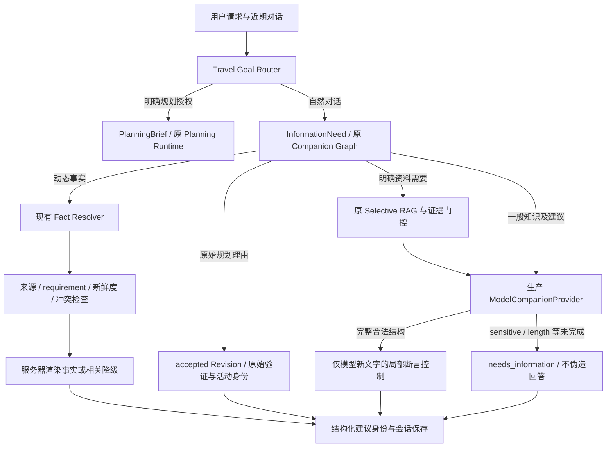

# Companion Answer Reliability Phase 1

执行日期：2026-10-12（文件名按任务要求保留 20261011）。基线 HEAD：`0b5010fe5a7b06dcec1ab7b159b5b337244247ae`，在现有未提交工作树上增量修改。没有 reset、部署、生产数据库写入或旧真实评估文件覆盖。

**验收：PARTIAL / OPEN。** 已改善已复现的价格、排队、人流及状态断言，并支持 Provider 未完成时安全返回；未证明任意模型输出的事实可靠性。C 仍可保持现有知识策略默认值，本次结果不是生产质量放行。

## 1. 真实调用链与根因

VERIFIED：`assistant_service.send_message` 按 Travel Goal 分流。Companion 经 `CompanionRuntime` → Graph 的 interpret/resolve/information/gather/generate/extract/handoff-boundary/prepare-persistence，最后仅保存会话回复及建议；正式规划另行建立 PlanningBrief。普通聊天没有 PlanningRun，模型没有 itinerary 写权限。

现有 InformationNeed 已在输入阶段区分通用知识、专业资料、动态事实及原始决定解释。Fact Resolver 在工具侧检查 requirement、来源、有效期、身份、冲突及 usable_as_current；天气和营业安排由服务器单独渲染。问题在于：普通建议的自由文本及 Suggestion 的 summary/reasons 不经过动态断言检查。模型虽然收到“不提供实时价格”的提示，仍可能主动加入价格和现场保证。

现有 Companion 真正接通的实时路径是天气和官方营业安排；门票价格、排队、人流、预约库存没有对应可用事实适配器。不能拿一个天气或营业结果证明模型额外生成的消费价格或人流断言。本次没有虚构新 Provider，也没有把本地 RAG 当作联网核验。

Provider 原有 JSON/schema 修复最多一次；不完整响应原本抛出 CompanionProviderError，由外层转成工具错误。现在 finish_reason 单独保留：sensitive 与 length 都不是 JSON 解析失败，也不算成功回答。

## 2. 失败样本分类与复现

原始证据来自 `companion_real_quality_20261011/review_unblinded.json`，另存固定失败夹具，未修改原证据。

| 样本 | 原始问题 | 分类与本轮处理 |
|---|---|---|
| Q021 | 评弹“几元一杯”、园林“小而静” | 价格需证据；现场安静和人流不能保证。逐条省略，保留园林/戏曲兴趣建议 |
| Q035 | “最大程度避开排队和人流” | 确定体验保证；局部控制，不把整个回答改成拒答 |
| Q044 | “几乎不用排队”“人少” | 无现场依据；保留建筑、街巷与慢走方向 |
| Q062 | 鸡鸣寺/同泰寺的时代及地点关系 | 历史实体关系问题，动态门控不能解决；保留待核验状态 |
| Q063 | 白堤被描述为白居易留下的堤 | 历史归属问题，动态门控不能解决；不能靠删除数字宣称修复 |

文化解释（如六朝列表、借景）、主观审美、用户明确偏好与条件策略分别处理。预算上限“预留100元”、每天两个体验、历史年代不是当前价格；“如果现场拥挤，可以换街巷”“不能保证免排队”应保留。主观“古城氛围”“造园意趣”也不因为存在数字或形容词被整段拦截。

独立核查：[南京地方志关于鸡鸣寺名称](https://dfz.nanjing.gov.cn/gzdt/202603/t20260304_5799793.html)与[南京民宗局寺院简介](https://mzzjj.nanjing.gov.cn/mzzj/njzjgk/njfj/201809/t20180927_1198623.html)的沿革叙述存在不同简化口径，不能把前身、现址和同名寺直接合并为无争议事实；[杭州网白公堤研究](https://hznews.hangzhou.com.cn/wghz/content/2019-04/17/content_7179005.htm)区分今白堤与白居易修筑的白公堤。上述网页仅用于评审，没有伪装成模型当时引用。前报告引用的中纪委白堤页面本轮抓取重定向失败，未把失败抓取作为新验证成功。

## 3. 修改范围与事实控制

- `backend/app/companion_answer_reliability.py`：有界本地分句控制；处理具体价格、排队时长/保证、现场人流/安静保证、营业/场次与预约可用性。同步处理 response_text、建议 title/summary/reasons、agent_claims 和 comparison，避免正文删了但保存的建议仍带断言。保留段落边界，空建议不保存。
- `backend/app/companion_graph.py`：只在新模型生成分支执行控制，记录静态触发代码；局部删句不会自动降为整段拒答。全部有效内容被移除则 needs_information。已保存解释和服务器证据渲染绕过此层。
- `backend/app/companion_information.py`：明确询问“今天排队多久”“现场人流”等进入动态事实边界；“不喜欢排队”仍是偏好，不强迫所有建议查询实时数据。
- `backend/app/companion_provider.py`：去除强制摄影提示，要求围绕用户问题给建议；新增 incomplete 的 finish_reason 保留及评估专用可见输出捕获。生产默认不开原文捕获。
- 新增 `backend/tests/test_companion_answer_reliability.py`、失败夹具及 `backend/evals/companion_answer_reliability.py`；后者复用生产模型客户端，逐例保存，拒绝覆盖已有原始结果。

没有新增 Agent、Graph 节点、数据库字段/迁移、用户画像或检索算法。没有额外 LLM 输出修复请求，也没有为了通过 sensitive 过滤而改写或重试请求。原有最多一次 JSON 格式修复保留。

此层是可测试的词法风险控制，**不是语义事实核验器**。“通常”“据说”不能成为证据，但未覆盖的句法、否定作用域、主观体验与现场状态的歧义仍会漏检。它不判断一个历史关系是否正确，也不把检索引用当作该句动态状态已核实。

## 4. 降级与过度拒答

预约缺失只解释日期/时段/可提交结果的核验方向；票价缺失指向官方票种、日期和优惠；天气、营业、交通、活动各自按问题降级。删除“小型知识库”“正式规划决定”等无关用户文案。要求出处但无资料时，直接说明来源不足，可以提供指定材料，不补造文献。

首轮完整回归 13 failed / 915 passed：5 项暴露摄影关键词删句会清空普通文化回答，8 项是降级措辞变化与既有断言不一致。撤销摄影硬删除，保留生成侧的相关性提示，并改为相关且明确“无法核实/现有来源不足”的措辞，没有削弱实时或来源合同。

后续真实结果暴露“清静得多”“人也少”“几乎不需要排队”等变体，补充复现测试；删句造成列表连接问题也补段落保留测试。全部中间失败日志保留。摄影/额外路线是否仍出现，由真实输出评审，不声称关键词过滤已解决相关性。

## 5. 真实 Provider 与过滤测试

MEASURED：进程覆盖 `PLANNER_PROXY_URL=http://127.0.0.1:7897`，不改 `.env`。生产 GLM `glm-5.3-flash`、OpenAI SDK 2.54.0、httpx 0.28.1，timeout 90s，网络重试0。最小真实请求成功：7.706s、137 Token。与前轮已定位的原 host.docker.internal 代理路径故障区分，本轮不重新猜测鉴权或模型名失败。

固定系统提示、同一 JSON 输出合同、temperature1/top_p0.95、reasoning low、max_output_tokens8000。正常独旅测试事先限定8次：单轮同题3次、带固定旅行偏好历史同题3次、另一正常独旅问题2次。8/8 completed，sensitive 0/8；没有请求改写、过滤重试、参数搜索或无限追加。0/8不能证明过滤率为零，也不能推断固定提示是过去过滤的根因。单独参数矩阵未执行。

真实四轮链：目的地文化 → 偏好 → 城市比较 → 明确规划。前两轮自然对话；第三轮达到8000输出 Token，finish_reason=length，明确 needs_information，不发布截断 JSON；第四轮正确路由 Planning。最终 Brief 用实际历史纯回放，仍是南京、3天，未创建 PlanningRun。Provider 状态及用量保留，不能称四轮全部模型成功。该初轮 length 请求的可见截断正文未保存，只有未完成状态/finish_reason/用量；最终 Provider 已将评估专用可见输出捕获移到完整性检查前，但本轮没有再次触发 length 来补造旧正文。

## 6. 测试、用量与实际输出

证据目录：`backend/evals/results/companion_answer_reliability_phase1_20261012/`。

| 记录 | 范围 |
|---|---|
| smoke.json | 最小真实调用，独立计费137 Token |
| real.json | 24条初轮记录，含旧P1题、文化/条件、实时缺失、8次过滤探测及四轮真实历史 |
| real_final_targeted.json | 4条新增真实定向复测，保留中间版本漏检 |
| real_verified_targeted.json | 4条进一步真实定向复测，保存模型原始JSON和当次最终输出 |
| final_delivery_replay_review.json | 最后修订的本地控制对以上原始真实输出进行回放；另含旧5失败题。明确为真实输出回放，不冒充额外真实请求 |
| delivery_metrics.json / verification.json | 成本汇总、测试与边界、质量门禁 |
| backend*.log | 所有完整隔离回归尝试，包括失败 |
| source_manifest.json / image_manifest.json | 最终被测app/tests/依赖与镜像绑定 |

32条记录中25次模型调用：24 completed/stop、1 incomplete/length，无格式修复重试；总49787 Token（另加 smoke137）。完整响应记录原始可见JSON、控制后草稿、最终 Runtime 输出、触发代码、来源/检索、实际用量与延迟；未完成响应的正文缺口如上，不伪造补全。不能把32条都计为模型回答。

完整响应的模型平均耗时8.731s；未完成的比较题67.022s。总 RAG 调用1次（来源缺失题），没有增加检索。最后本地回放门控平均约0.70ms、最大约3.67ms；24份完整真实输出原文/控制后的配对不增加Token或模型调用。这是本地删除/校验成本，不代表提示词改动没有 Token 成本；本轮与前轮网络/上下文不同，**没有可识别的旧新提示因果延迟/Token增量**。

旧Q021价格、旧Q035保证、旧Q044免排队被定向移除，文化观察线索和偏好建议保留。真实复测Q035保留支巷/园林/傍晚步行方向，Q044保留水乡和漫步方向，没有替换成整个拒答。条件策略仍有工作日、替代片区、步行节奏等可操作建议。

人工体验评审仍有问题：删句可留下列表标题与内容衔接欠自然；昆曲/评弹的具体场馆场次表达及“冷门/清幽”的主观与状态界限尚待核验。Q063新回答仍将白堤与白居易关联，不能宣称历史归属错误已彻底解决。模型未完成的降级虽诚实，但城市比较中没有提供比较内容，体验较保守。评审由 Codex 记录，非独立人类盲评；未核实准确性标为 pending，不计算整体质量排名。

## 7. 验收与后续优先级

- P1：继续 OPEN。词法控制不能保证所有动态断言都关联可信证据；历史人物/地点关系错误与完整真实 accepted Revision 解释验收仍未完成。
- P1：Provider 偶发 sensitive 根因未复现；本轮发现长输出耗尽。下一轮应独立评估长度与结构化多轮稳定性，不能通过规避安全过滤解决。
- P2：局部删句的自然度、否定/条件作用域和主观体验边界需独立人工留出集评审；本轮已发现并记录真实失败，不继续无限扩张正则。
- P2：需要价格、客流、预约状态时仍缺事实适配器；可复用项目真实 Provider，但属于后续接入任务，不能本次宣称实现。

默认 C 的选择性 RAG、证据门控、BM25/向量接口/Hybrid能力不变。个性化仍来自现有明确偏好与近期对话，建议先控制再保存；不增加用户画像，不改 Planner/Revision/确认/版本 fencing/Validator/Execution/Recovery 的权限和流程。自动边界回归可以证明已有合同未退化，不能代替未执行的生产业务全生命周期验收。

## 8. 完整回归与证据绑定

VERIFIED：最后独立 Docker test image / PostgreSQL17 临时测试库回归 `938 passed, 2 warnings`，exit0，日志 `backend_clean.log`；比909基线增加29项输出可靠性测试。警告是既有 Starlette 422状态命名弃用，未新增业务失败。Web `125 passed`，`npm run build`（含 tsc --noEmit）exit0。最后的列表空行修复前还有一次 `1 failed / 937 passed`，保留 `backend_delivery.log`；不能用中间失败日志代替最终通过证据。

最终163项 app/tests/依赖文件与被测镜像逐项 SHA256 一致；verification.json、source_manifest.json、image_manifest.json 及 evidence_manifest.json 可复核。测试使用单独 Compose 项目 `roamsync-answer-reliability-test`，临时PG已清理，未影响其他容器。未修改测试预期以掩盖新的事实风险，也未运行本机默认数据库下的 DB 测试。真实 accepted Revision 解释的端到端Provider测试、独立人类留出评审与生产过滤率仍未验；现有原始解释与 mutation/validator/navigation/recovery 自动回归通过不等同这些未执行项完成。

## 2026-10-12任务收尾状态

Answer Reliability Phase1标记为阶段实施完成，停止功能修复和模型实验。生产质量门禁继续PARTIAL / OPEN。收尾核对当前树与938快照存在4变化+2新增，原通过仅适用于已验快照；后续saved_plan_notes等改动保留并独立验收。详情见 `COMPANION_TASK_CLOSEOUT_20261012.md`。原评估文件未修改。
