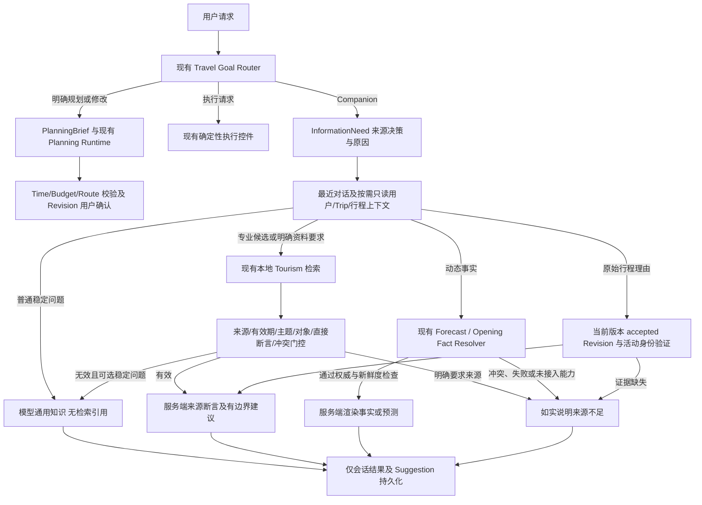

# Companion knowledge strategy — Phase 0 audit

VERIFIED against the working tree on 2026-10-11; previous handoffs are historical.

## Actual chain and status

`assistant_service.send_message → route_travel_goal → CompanionRuntime.run →
interpret_goal → resolve_conversation → determine_information_need → gather_context
→ generate → extract_outcome → handoff_boundary → prepare_persistence → session JSON`.
Companion has SELECT-only context and session persistence, no formal mutation tool.
Explicit Planning alone builds PlanningBrief and enters the existing tool router.

Already implemented: ordinary stable conversation defaults to model general
knowledge (`general_knowledge_allowed`), no unconditional RAG. Source/verification
requests select the lazy reviewed knowledge tool. Its adapter explicitly requests
`lexical`; the service retains Chinese BM25, optional embedding/cosine and RRF.
Embedding interfaces/algorithms exist; no production vector index/provider in
Companion. Seven reviewed Hangzhou documents are not destination coverage.

Evidence is filtered by destination/type/tags/expiry in the adapter and by reviewed
assertion topics in the graph. Raw BM25 > 0 only means a ranking hit; service
`knowledge_sufficient` currently means nonempty hits without live/decision flags.
It is not proof of relevance or entailment. Factual source answers are rendered
from assertion IDs, mixed answers permit labelled advice. General mode uses free
model prose without citations. Source prompts intentionally prohibit filling
missing facts from memory; this restriction does not apply to general mode.

Already implemented: CompanionFactAdapter plans city-level Open-Meteo forecasts
and specific official venue opening schedules through TravelFactService with
freshness/authority/conflict handling. Unsupported dates, subjects and outages
degrade without model generation. AMap route/POI and Tavily search exist elsewhere
in the project; Companion has no general search/traffic/ticket/event query tool.
`InformationNeed.search_required` is only an interface field. Local RAG is not
network search. General cultural customs must be distinguished from dated events.

Context: last 12 turns, source-turn preference statements and persisted
Suggestions; SELECT-only saved TripPreferences, scoped current itinerary and
accepted Revision rationale. Preference statements store explicit user wording
and source turn; there is no inferred-preference contract or learning service.
No long-term profile, automatic summary or historical-trip memory
service is implemented. History/culture currently clears preference projections,
which can discard relevant explicit preferences unnecessarily.

Explanation requires current-version accepted validated Revision and exact
surviving Activity/time, or originating saved Suggestion. Missing rationale is
reported, never reconstructed. Suggestion is discussion; PlanningBrief is explicit
user authorization/context; neither is an itinerary or accepted Revision.

## Minimum changes

Reuse InformationNeed and the existing graph, with deterministic decision reasons,
optional specialist retrieval, independent provenance/support/freshness gate,
general fallback only for optional stable requests, and fixed A/B/C evaluations.
Keep source requests, live facts, formal rationale and all planning validators
strict. No new Agent, corpus, provider, database schema or UI debug display.

Final implementation and measured evidence are appended after verification.

## 实施内容与边界

| 文件 | 最小改动 |
| --- | --- |
| `backend/app/companion_information.py` | 确定性来源决策及原因；有限专业主题信号；日期活动、交通耗时与一般文化区分；来源请求保留证据路径 |
| `companion_contracts.py` | 在已有 InformationNeed 增加决策、原因、来源要求、可选检索字段；检索摘要增加拒绝原因及通过数量；旧 JSON 有默认值 |
| `companion_evidence_quality.py` | 独立审核断言门控：主题/对象/直接支持、来源类型与权威、审核时间/有效期、重复断言及遗产年份冲突 |
| `companion_graph.py` | 选择性门控；可选稳定知识失败回退；不再清空显式偏好；阻止一般回答伪装已检索引用 |
| `companion_runtime.py`, `config.py` | `COMPANION_KNOWLEDGE_STRATEGY=selective/general_only/forced_rag`，默认 selective，构造参数可覆盖用于评估 |
| `companion_provider.py` | 清除通用 Prompt 中误放的来源模式约束；明确偏好来源；成功与失败模型调用均记录时长和 Provider usage，日志无对话/错误原文 |
| `companion_context.py` | 按需 SELECT 的 Trip 摘要补齐 ID/version；原始理由验证不变 |
| `travel_goal_router.py` | 补齐显式“把当前行程改得轻松一点”识别；问句、否定和假设不获得修改授权 |
| `backend/evals/companion_knowledge_strategy.py`, `fixtures/companion_knowledge_strategy_v1.json` | 固定18问题/上下文/规则及 A/B/C 可复现评估；保存输出、使用量、时长和待人工评分项 |
| `backend/tests/test_companion_knowledge_strategy.py` | 来源真实性、门控、回退、偏好、日期事实及规划边界回归 |

没有改动 Tourism Knowledge 算法、语料、PlanningBrief 结构、Planner、
Validator、Revision 接受流程或 Navigation/Execution/Recovery。新诊断字段仅
保存在结构化结果；Web 默认展示方式未改动。开发计量只存枚举、状态、
时长与用量；评估输出使用固定非私人问题。没有部署或生产数据库操作。

普通问题不依赖 RAG 的理由：七文档库无法代表模型通用文化知识的覆盖面。
把检索命中当作回答前提，会把语料空缺误变成模型无法回答。来源模式仅
在要求依据或可能需要专业材料时使用；通用知识仍标为未核验，绝不标成
检索证据。现有通用模式已经存在，本次是补齐策略与门控。

门控不读取原始 BM25 分数，也不设跨查询固定分数阈值。现有服务的分数
是排名分数，RRF 分数更不能当概率。使用现有审核断言与主题/范围合同，
并在评估集测试无结果、低可信、过期、无直接支持与冲突。稳定历史资料
不会因为经过任意天数就判作陈旧；semi_stable 必须有有效期，审核缺失、
未来时间或明确过期被拒绝。审核资料并不等于本轮联网重新验证。

## 新调用流程

这些分支可组合；稳定资料和动态事实独立渲染。本轮没有增加一个能把
任意通用回答与实时事实自由合成的新 Agent。未接入的实时能力保持明确
降级；复杂混合问题仍可能回答保守，这是已知能力限制。

## 决策例子

| 问题 | 策略与行为 |
| --- | --- |
| 南京为什么叫六朝古都 | general_knowledge；不检索，模型一般历史解释 |
| 苏州和南京哪个更适合慢节奏旅行 | context_required；通用比较及按需偏好 |
| 我不喜欢热门景点，有什么思路 | context_required；引用本轮显式偏好，不编造旅行史 |
| 西湖碑刻的训诂有什么特点 | rag_candidate；当前库缺少直接断言，回退一般背景并保留不确定性 |
| 西湖申遗是哪年，请给来源 | rag_candidate；审核断言与规范来源渲染2011年 |
| 南京历史，请给文献来源 | rag_candidate；库不覆盖，说明来源不足，不把通用知识包装成文献 |
| 明天天气 / 场馆开放 | live_fact_required；现有真实工具，不可用则降级 |
| 今年灯会具体时间地点 / 交通耗时 | live_fact_required；当前 Companion 无对应查询工具，禁止模型补数值 |
| 南京元宵灯会的文化特色 | general_knowledge；一般民俗与本年度活动信息分开 |
| 为什么行程在18点安排西湖 | mixed；原始 Revision/活动身份边界，旅游知识不证明决定或当时实时条件 |
| 帮我规划南京三天 / 修改第二天 | Planning；显式授权后继续原规划流程 |

## A/B/C 方法与可测结果

18例包含16个 Companion 请求及2个显式 Planning 路由检查，共54个组合。
问题、最近对话、固定无数据库 Reader、审核语料和评审规则相同。
A=General Only；明确来源/动态事实仍执行安全降级，不允许纯模型猜测。
B=Forced RAG，稳定 Companion 请求均尝试旧检索/审核断言路径，不启用新增
质量门控；动态事实及正式理由继续保留原安全边界。
C=Selective + 新门控。并非将 Forced RAG 当作此前所有请求的真实生产行为。

真实模型配置固定 glm / glm-5.3-flash，low reasoning，8000输出上限，
SDK retry=0，至多一次格式修复。温度使用现有 Provider 默认，未伪称固定
采样种子或完全确定性。实时工具在此对照集中刻意缺席，用于验证降级；
已接入天气、开放时间的成功/冲突/失效行为由现有 Companion/Fact 回归验证。

MEASURED：受控生成（非真实模型）54/54边界检查通过。

| 指标 | A | B | C |
| --- | ---: | ---: | ---: |
| Companion 问题数 | 16 | 16 | 16 |
| 本地 RAG 调用数 | 0 | 12 | 5 |
| RAG 调用率 | 0% | 75% | 31.25% |
| 全部18例自动检查通过 | 18 | 18 | 18 |
| 受控 Companion 平均时长 | 74.06ms | 79.61ms | 75.43ms |
| 本地检索总时长 | 0 | 12.58ms | 2.94ms |
| 真实模型 Token | 未测 | 未测 | 未测 |

C 相比 B 少7次检索（58.3%）；这是固定受控集的调度测量，不能外推生产
延迟、费用或回答质量。测试使用真实本地语料与检索；低可信来源使用
明确标记的污染变体。A在显式申遗来源题中说明证据不足；B/C产生相同
`west_lake.heritage_inscription_year`审核断言和UNESCO来源。这证明此题
来源链能提供通用模式没有的可核对依据，不能证明所有专业问题都有增益。

真实模式第一个A组请求经历7.529s后抛出 PlannerProviderError，没有完成
输出或usage；保留 `real.json`，complete=false，按首错停止。初版计量只
记录完成响应，因此其中model_calls=0表示没有记录到完成响应，**不表示
没有发起请求**。已修正后续计量，包括失败尝试与标准错误码；没有用重跑
覆盖该原始证据。初版未保存细分错误码，根因 UNKNOWN，不认定为特定网络、
额度、认证或模型质量问题。真实A/B/C、Token、真实回答延迟及人工质量
评分尚未完成，不能宣布C质量最好。

评估评分表保留事实准确性、完整性、相关性、自然度、幻觉为空值；引用
引用身份、无Companion handoff及动态事实不调用生成等合同可自动检查。
一般模型答案的事实准确性和自然度仍需要人工审查；句子含有合法引用
并不能证明蕴含关系。专业增益应按同题盲评、断言覆盖、引用真实性及
错误/拒答数量结合Token/延迟判断；没有材料覆盖的专业题不能以调用次数
判作成功。本轮没有扩大知识库来制造增益。

证据目录：`backend/evals/results/companion_knowledge_strategy_20261011/`。
`controlled.json` 为受控输出与指标，`real.json`为原始未完成真实批次。

## 回归与未完成能力

VERIFIED：最终独立Linux/Python3.11/PostgreSQL17.11新空库迁移0→0034，
后端891通过/0失败/0跳过/2个既有Starlette弃用警告，66.31s；包含新增37项
策略回归及现有Companion、事实、正式规划、版本fencing、执行、导航与恢复
测试。Web125通过，typecheck/build通过；测试有React act警告但无失败。
后端日志和完整结果记录于同目录 verification.json 与 backend_final.log。
中间一次全量回归882通过/5失败：新增计量直接读取旧测试精简配置对象的
缺失planner_provider字段，已改为可选读取；保留backend_intermediate.log。
初次Windows选择测试129通过/1失败是Psycopg ProactorEventLoop不兼容，发生
在建立连接前；正式验收采用独立Linux/Python3.11/PostgreSQL17测试项目。

个性化规划保留原偏好、用户确认、PlanningBrief与版本fencing；新增上下文
只读，通用文化路径也保留用户明确表达的偏好。尚无推断偏好存储合同，
不得把模型推断当已确认记忆；本轮未建设完整画像或长程旅行史服务。

全部Tourism Knowledge可复用能力保留：中文BM25、Embedding接口、余弦检索、
RRF、入库与过滤。本次没有配置真实Embedding Provider或在Companion启用
Vector/Hybrid。AMap/Search在其他Runtime存在不等于Companion能查询任意
交通/票价/活动。后续应先恢复真实评估并完成人工评分；再按明确需求复用
现有Provider的类型化端口，补充独立留出集。有限词表、审核元数据信任、
一般文字引用过滤和窄年份冲突规则都不是通用事实/蕴含证明器。未做生产
部署、浏览器E2E或真实GPS验证；已有生产发布门禁仍然有效。

## 2026-10-12任务收尾状态

RAG定位调整标记为工程任务完成，停止本轮开发。保留C默认知识策略建议；生产质量门禁继续PARTIAL / OPEN，不把工程完成当作生产放行。详情见 `COMPANION_TASK_CLOSEOUT_20261012.md`。原评估文件未修改。
