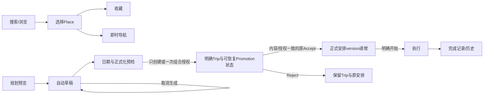

# RoamSync V2 数据生命周期与迁移提案

日期：2026-10-15。第二轮修订CANDIDATE FREEZE/VALIDATION REQUIRED；本轮未执行正式迁移或数据清理。现有外键依据 `backend/app/database.py`；目标契约见[架构](ROAMSYNC_DOMAIN_ARCHITECTURE_V2.md)，决策见[ADR](ROAMSYNC_ARCHITECTURE_DECISIONS.md)。方向已原则接受，生命周期实施仍须最终批准。

## 1. 不同状态代表不同承诺

查询结果不是收藏；Suggestion不是Place；草稿不是正式旅行；候选不是正式安排；日历日期结束不是实际旅行完成；外部地图唤起不是到达。不存在为了方便旧Planner而默默创建用户Trip的默认路径。

**VERIFIED**：当前TripResponse.status为upcoming/active/completed/archived，结合日期/archived状态呈现；`database.py:83`实际使用UTC日期而非Trip.timezone。TripExecution.status另外表达真实执行。目标计划阶段按Trip当地日期派生，并继续区分“按日期已结束”和“执行已完成/未记录”，不倒填用户真实经历；跨午夜与不同时区必须回归。

## 2. 逐对象生命周期矩阵

| 对象 | 创建操作与关联 | 转换/修改 | 取消/归档/删除 | 追溯与时效/可清理范围 |
|---|---|---|---|---|
| 可信单owner/未来账户 | 首期受控入口服务端确定唯一owner，客户端不得自填归属 | 未来账户/跨设备需单独身份与映射 | 删除本地数据/未来账户单独命令 | server owner常量不等于公网鉴权；公开/跨设备门禁尚未通过 |
| BrowseState | 选择区域、筛选、详情/地图切换；view_id/tab | 可随时改变，仅作用本视图 | 关闭/清除后可丢弃 | 定位与滚动等优先本地短期；不是长期偏好 |
| Place/ExternalRef | 搜索返回身份按需物化，收藏/导航前必可解析 | Provider刷新投影，external ref唯一；纠错/合并存映射 | 移除失效公开缓存不影响用户收藏引用；保留tombstone或历史快照 | 不按同名合并；历史快照不随最新名称覆盖 |
| ContentAsset/评论引用 | Provider授权取得图片/内容；关联Place与Source | 刷新或来源撤销 | 授权终止按许可移除raw资产/URL，保留允许的来源元数据 | 缺图用说明；raw缓存期限由许可，不凭产品任意永久复制 |
| Source/Fact/Evidence | Provider/API/人工审核/用户报告；subject+scope+time | 新证据追加、冲突标识；旧证据不可假刷时间 | 未引用缓存可到期清理；正式决策引用保留许可允许的最小来源快照 | current/forecast/营业公告/路线/库存各自TTL；无统一时效 |
| RouteQuote | 任意起终点查询；不关联Trip也可用 | 端点/模式变更生成新quote；刷新不同revision | 未使用quote可到期回收；导航保留启动快照 | duration/ETA时效短于地点身份；估算quote不能启动真实GPS |
| Favorite | 明确收藏Place；owner+place唯一 | 单条备注/分类（可后续） | 取消即移除收藏或标removed；重复取消幂等 | 不删除Place/Trip；行为Evidence按用户隐私选择清除 |
| AssistantSession/Message | 首次打开/显式新会话；owner、各消息task binding | 追加幂等message；会话标题/主题可改；目标逐消息 | 清除会话需使待确认Action失效；全局会话不随Trip删除级联 | source turn用于解释偏好；删除原消息后的最小来源留存须用户可控 |
| Suggestion/ActionProposal | Assistant当前turn输出，保存身份/来源 | liked/rejected只互动；解析Place才能动作 | action到期/取消/相关version变更失效 | 原理由、提案与实际执行分开；Suggestion喜好不能变正式必去 |
| PlanningDraft | 用户请求预览/手动新建；owner，destination/duration，日期可空 | 需求变更version+1；生成自动保存；可另存草稿 | 取消Run保留Draft；归档可恢复；明确删除可按恢复策略tombstone | 草稿自动保存不等于确认出行；不进正式Trip列表 |
| DraftRun | Draft规划/重试；draft_id/input_version/hash、purpose/origin | queued→running→succeeded/failed/cancelled；CAS发布 | queued/running取消；超时failed；终态只读 | 保存输入摘要/结构化输出/校验/错误/Provider用量；不存隐藏推理；未引用实验run可按政策清理 |
| DraftPromotion | 用户选create_only/create_and_adopt；绑定draft/version、PreparedPlan/content/evidence hash和授权 | 推荐P1多事务：建档→formal pending→原Accept guard；状态/目标引用持久化 | T1前取消无Trip；T1后失败Trip可见保留；授权消费前撤回阻止Accept，之后另行正式修改 | operation+key/body hash唯一；内容变化needs_review；不能声称全链原子 |
| Trip | 明确表单/助手确认/草稿建档/明确复制；owner/purpose/origin | 版本保护变更；局部约束与日期变更重校验；完成与归档分离 | 归档可恢复；删除明确列关联影响，按策略可恢复；active执行先停止 | 历史完整安排与来源保留；旧origin_unknown不自动清理 |
| TripPreferences | Trip创建、用户明确保存局部约束 | 独立version；不自动吸收浏览推断 | 随Trip可归档；删除按FK/留存策略 | 预算是Trip局部，不跨城借用 |
| DayPlan/Activity/RouteLeg | 当前Trip创建生成Day；手动显式编辑或Accept创建Activity/Route | 按原版本/活动锁/执行冻结/Validator修改；RouteLeg可重建 | 受正式服务控制，不能草稿清理级联 | Revision快照和执行事实保留身份与内容；不全盘改PlaceID |
| PlanningRun/PlanRevision | 正式Trip明确规划或可靠Disruption/experience trigger | 现有阶段至accepted/rejected/failed；pending旧版本superseded；cancelled为持久预留，不表示已有formal取消API | 保留原clarify/accept/reject边界；终态retry新Run；Draft/Promotion取消独立设计 | Accept事务重验证，Trip版本递增；拒绝反馈限定Trip/day/version |
| TripExecution/ActivityExecution/TravelEvent | 明确开始执行或已有Trip的atomic navigation/start；用户停留/离开 | 执行status/幂等client_action；只信确认事件/有效观测 | 完成/暂停/恢复/取消遵循正式生命周期 | 日期不能补造执行；用户事件用于追溯；不能让Instant生成Execution |
| 正式NavigationSession/Detection/Disruption | 当前正式相邻活动对、执行、版本；可信观测确认影响 | sequence、route_revision、version fencing；自动去重recovery | cancel/complete/superseded；Accept更新后旧会话不可复活 | 保留影响链与接受依据；临时定位只存必要最新值，来源合规 |
| InstantNavigationSession | 用户明确应用内持续GPS；可信owner/device、quote、端点/模式；external不建受控会话 | ready/starting/active/rerouting/suspended及completed/cancelled/failed/expired，按架构状态机 | 本地立即stop+持久StopIntent，断网重试；终态幂等；重启先终止后考虑恢复 | 正式表零写；设备槽互斥；precise latest值与必要终止命令/摘要分离 |
| External HandoffReceipt | 路线/地点显式交给外部地图，优先本地 | attempted/dispatched/failed/returned/用户手动报告；不是GPS active | 可丢弃或按本地历史管理；不支持RoamSync控制外部SDK取消 | 不自动到达，不为每次跳转写server Instant；需要审计另存明确handoff事件 |
| Preference/Evidence | 用户明确偏好/修正，或有同意的收藏/反馈/行为证据 | source/scope/confidence/supersedes；推断可复核 | 用户编辑、暂停推断、删除证据/偏好；撤销生效 | 浏览时长仅低置信Observation，不直接强推断；硬约束不能被覆盖 |
| ExperienceFeedback | 用户对Place/体验明确报告，可选Trip/Activity | 用户修改反馈与版本；推断反馈不自动替代自述 | 用户撤回；关联Trip删除后按政策保留或移除Place级反馈 | 导航到达不等于满意；保存用户陈述及来源 |
| HotelQuote（可选） | 授权Provider按日期、人数、房型请求 | 新quote绑定条件；快照不可改价冒充原报价 | 到期不能用于可售保证；取消只是放弃查询，不是取消订单 | 含币种/单位/税费/取消条件/valid_until；没有Provider时不存在假quote |

精确保留天数、草稿自动回收期、删除恢复期均为OPEN，必须用户可见、可配置、符合实际Provider许可，不能在本轮编造已批准政策。历史正式决策只保留必要证据元数据；不能以审计需求为理由永久保留用户所有定位/聊天原文。

## 3. 状态、版本与幂等

查询不建Trip。创建键不复用用户文本的hash作为永久唯一，因为用户可能明确创建两趟相似旅行；前端生成request key，服务端绑定owner/operation/body hash，限定重试窗口，保存结果引用。message_id、client_action_id、run trigger_key现有机制分别保留。Draft变更使用expected_version与input hash，正式修改使用Trip.version；Navigation使用state_version/route_revision/sequence三种用途，不互相替代。

正式化修订：keep只保留Draft；create_only明确建Trip，不默认LLM/采用；create_and_adopt可以一次组合确认，绑定真实日期PreparedPlan、semantic content/evidence hash、可撤回授权。推荐P1持久DraftPromotion协调T1建Trip、T2正式candidate、T3原Accept及授权guard，逐提交点恢复；不是一个现有原子事务。mapping与对应提交不可留下不可对账窗口，save/accept内部commit的最小适配必须先验证。内容或事实条件实质变化needs_review，原授权不批准后台新模型方案；已建Trip失败不删、不另建。

P2仅为备选：所有Provider/模型/路线预备在事务外，拆出save/accept无commit核心与Run持久化后，短SQL段组合建档/候选/接受。该拆分与原正式回归未执行，不承诺现在可行。Apply/Cancel以锁内授权消费提交为线性化点；接受先提交则返回已采用，不能假称撤回已回滚正式安排。详细失败状态见架构§5。

## 4. 旧数据兼容与展示

**禁止规则**：不得依据Trip名称含test/demo、日期过去/未来、内容为空、行程不完整、数量多就判断测试并删除。不把规划失败旅行自动搬为草稿。Uuid碰巧为固定demo ID也不能单独证明其现有内容可删。

新元数据建议：purpose=`user|demo|evaluation|compatibility_draft|legacy_unknown`；origin=`manual|assistant_confirmed|draft_promotion|duplicate|seed|evaluation_runner|legacy_import|unknown`；source_operation_id、schema_version、created_by/owner、可选promotion source。目的与来源分开；权限端口决定purpose，不接受普通客户端要求写evaluation以绕过正式保护。

迁移旧记录时只给无来源证据的行设置`legacy_unknown/unknown`；所有原内容/ID/版本保留。确实有已保存seed/评测记录、精确映射和负责人确认的记录可以追加已验证provenance，但仍不自动删。新实验只在独立数据库/namespace运行，开发UI明确experiment，不复用正式owner列表；固定fixture身份和环境守卫双重检查。

旧旅行初期继续列在“既有旅行”，可标“用途待确认”；已明确归档状态照旧。用户可以批量选择“保留为正式/归档/导出后删除”，每项均预览影响与恢复机制；不要求每个用户先整理历史才能使用探索。旧AssistantSession以legacy_topic访问，不自动将所有聊天复制进默认会话；当前绑定和run link保持恢复兼容。

## 5. 外键与兼容代码

**VERIFIED**：当前Trip关联TripPreferences、DayPlan、PlanningRun、PlanRevision、PlaceCandidate、SourceRecord、Expense、TripExecution、NavigationSession，许多`ondelete=CASCADE`；Activity→PlaceCandidate为RESTRICT；AssistantSession.trip_id也是CASCADE（database:793）；Navigation活动/RouteLeg引用存UUID而非FK，依赖版本快照。

因此：

1. Session先增加可信owner与scope=legacy_trip|legacy_unbound|global及legacy Topic/tombstone映射，再切按owner+scope+明确session/topic的adapter，最后将旧FK改SET NULL。旧Trip会话删目标后仍legacy_trip，原本创建前null会话才是legacy_unbound，新global另有显式scope。旧null检索/reset只能命中legacy_unbound，不能因FK置null误读/清空原Trip历史或混入新global。旧消息尽量原地保留、不全历史复制进prompt；删除target撤销未消费Action；混版本/副本迁移需验证，不能只改DDL。
2. 给PlaceCandidate增加可空canonical_place_id，旧snapshot保留原candidate identity/source；未映射行仍可正式规划，不因V2要求映射阻塞。
3. 新Instant表不借用Trip FK或ExecutionSubject。正式Navigation相关表本阶段不改空值规则和唯一live约束。
4. 新Draft/DraftRun独立，正式PlanningRun/Revision保持非空Trip与原constraint。DraftPromotion以同一持久对象记录映射、operation状态、授权hash/撤回与目标引用，不再另造一张万能任务表；删除Draft不可级联删除Trip/已接受Revision。删除授权源后未消费Grant失效，已采用事实仍按正式历史与隐私政策处理。
5. 全局Favorite/Preference/反馈与Trip可选引用删除要明确SET NULL/快照，不使用Trip CASCADE丢掉用户收藏或长期偏好。
6. 删除Trip先处理active执行/导航、候选和引用；当前hard delete API在V2保留兼容但新UI优先归档、可恢复删除流程。正式历史快照与隐私删除冲突由公开政策决定，不以技术方便默认永久保存。

## 6. 迁移顺序与幂等

仅为计划，正式执行前另获批准并保存备份/验证恢复。本轮测试空库运行旧迁移不等于批准V2正式迁移。

| 步骤 | 操作 | 幂等/门禁 | 回滚 |
|---|---|---|---|
| M0 冻结 | 整合经审查源码、记录HEAD+dirty manifest+实际镜像；数据只读计数/引用完整性/Schema版本；验证可恢复备份 | 每份快照有hash、范围、日期；禁止把本轮测试数继承到另树 | 无正式写入 |
| M1 扩展 | 串行Alembic新增Place/ref/Favorite及来源字段；单用户owner策略获确认；新增字段可空并兼容旧代码 | 迁移version唯一；旧应用测试；索引部署锁影响评估 | feature flag关闭，旧代码不依赖新字段；不删新用户数据 |
| M2 回填 | 分批读取旧候选、证据充分才关联Place；origin_unknown不变；迁移ledger记录before/after与映射hash | `(migration_id,entity_id)`唯一；按版本CAS；再次运行0重复；歧义进入报告 | 根据ledger撤销新增映射，不回滚期间用户编辑 |
| M3 新读路径 | Web/Android feature flag读取Place/收藏；旧Trip候选adapter仍可用 | shadow compare identity/geo/source；Provider和授权契约验收 | 回到旧read路径，新收藏仍可导出/管理 |
| M4 即时导航 | GPS spike后新增Instant及device互斥/终止持久机制，typed binding；external仅本地交接 | 无Trip写入；正式恢复回归；真机/断网终止gate | 关新start但保留终止/读状态；不能让用户无法结束 |
| M5 全局会话 | scope/owner与legacy映射→检索adapter→FK SET NULL；新global不再受Trip级联 | 并发/旧客户端/删除Trip/被删target tombstone/重复迁移/rollback | 关新创建但新消息保留；不恢复CASCADE去删V2历史 |
| M6 草稿 | Draft/Run与DraftPromotion operation/授权，P1分阶段映射；formal约束不变 | 无日期、幂等、内容hash、cancel/apply竞态、逐提交故障恢复与Accept回归 | 禁新promotion，已operation仍可读/取消/对账，已创建Trip保留正式路径 |
| M7 偏好 | Evidence/Preference/Feedback与用户权限；先显式再软推断 | source/scope/撤回/删除链路，显式要求优先 | 关闭推断，显式偏好仍可管理 |
| M8 收缩 | 使用量证据确认旧路由不再依赖，逐一停止兼容写；归档可恢复的明确兼容记录 | schema/code兼容窗口结束有证据；不以日期到了自动drop | 保留备份/导出与adapter，单独批准不可逆收缩 |

owner回填若无法从当前单用户环境可靠指定拥有者，应阻断公开多用户迁移；不能让未知所有权数据公开给任意账号。单用户开发可继续内容/导航/草稿mock工作。

Migration owner统一管理Alembic编号与head，任何并行工作树不得各自生成同父迁移后随意合并。M编号表示单一Schema依赖顺序，不要求A/B/C全部串行；不相依的纵切使用已批准契约/fixtures并行，正式迁移仍按依赖逐次执行。Provider事实缓存与不可变正式证据不双写成两个“最新真值”；只在需要时做可对账映射事务，不同步两套完整草稿/Trip树。

## 7. 测试、安全清理与回滚验收

- 空库、代表性旧库副本、含部分映射库、失败中断库分别跑迁移；重复回填、Unicode名称、重复Provider ID、歧义同名、被删除来源、CAS并发都要覆盖。
- 迁移前后验证主键/版本/正式快照/expense/execution数量与内容指纹；mapping字段是允许差异，正式内容不得变。迁移运行前列出允许字段变化。
- rollback演练既要旧应用能运行，也要V2期间创建的Favorite/Draft/Instant不丢失。关闭flag优先，除非证明安全且获单独批准不直接downgrade/drop。
- 活跃Instant停止/取消路径与正式Navigation停止/恢复路径始终可达，不能用关闭入口让用户卡在导航状态。
- 可清理：未引用且许可允许的过期POI/quote/raw cache、明确evaluation库、明确取消的临时job资源；都需scope/owner/用途证据。不可因过期清掉formal snapshot引用的来源元信息。
- 清理必须有dry-run清单、精确目标/引用检查、审计记录和恢复策略；不是本轮执行事项。旧origin_unknown永不进入自动清理。
- 用户隐私删除须覆盖备份保留策略、位置观测、原消息/证据、模型/Provider请求日志；外部已发请求的删除能力如未知应说明，不伪称可控。

最终硬不变量：preview不建Trip；导航无Trip不写正式execution/recovery；删除Draft不删Trip；Trip删除不删全局助手/收藏；模型返回不替用户批准；新实验和来源不明旧数据不会混淆。实施依赖见[路线图](ROAMSYNC_DEVELOPMENT_ROADMAP_V2.md)。
