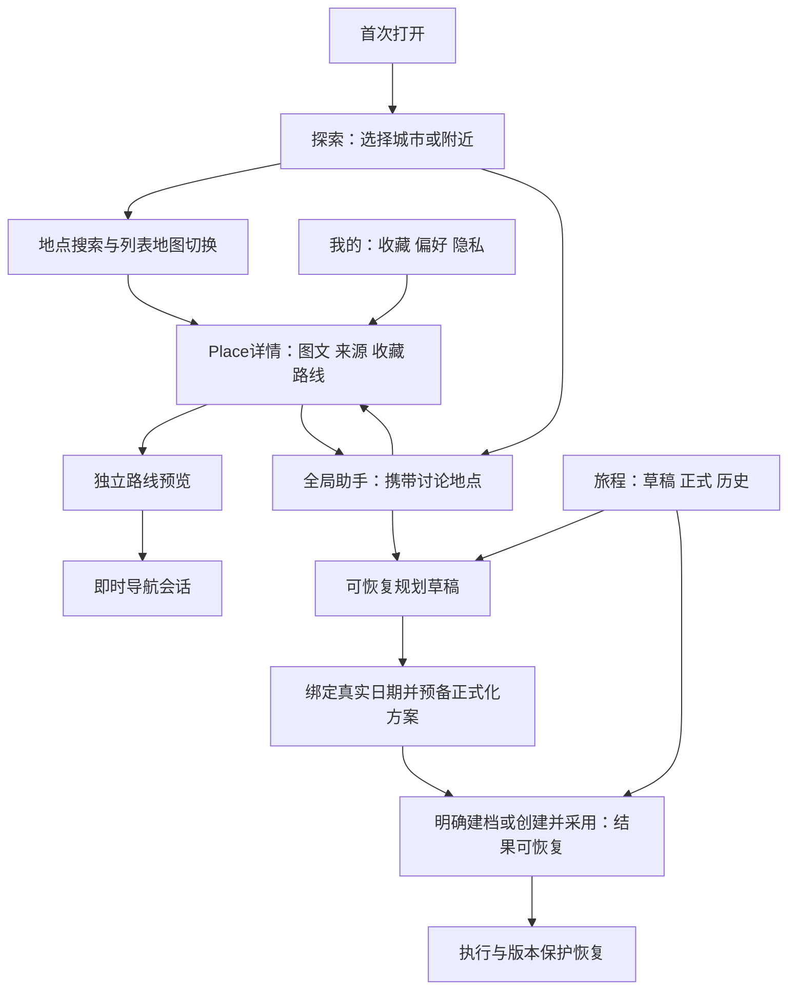

# RoamSync 2.0 产品定义（第二轮修订候选）

日期：2026-10-15，Asia/Shanghai。状态：方向已获第二轮原则接受，设计为CANDIDATE FREEZE，等待最终批准；不是已上线说明。现状以[审计](ROAMSYNC_CURRENT_STATE_AUDIT.md)为准，技术契约以[架构](ROAMSYNC_DOMAIN_ARCHITECTURE_V2.md)为准，待执行验证见[实施准备](ROAMSYNC_IMPLEMENTATION_READINESS.md)。

## 定位、用户与范围

个人旅行助手：用户自己探索时提供好用的地点、地图和收藏；用户不想比较时帮助找到合适选择；用户有正式安排时帮助协调执行和调整。主要用户是陌生城市中的自由旅行者，以及愿意将正式多日计划交给助手协助的普通旅行者。先在已有国内地图覆盖内做一个可验收城市纵切，不承诺全球酒店交易或全天自动监控。

内容和助手是两条平等入口，Trip是正式旅行的对象，不是使用资格。所有推荐都能回到真实Place；泛文化建议不伪装成已解析的可导航地点。没用AI也应能完成搜索→详情→收藏→路线。

本轮边界：先受控单用户体验，owner由可信服务端入口确定，客户端不能自填归属；公开多用户与跨设备同步另设门禁。预览自动存草稿；建档与采用具体安排是不同授权范围，但用户可以通过一次明确的“创建并采用当前方案”组合确认。预算可不填。导航是否建Trip从来不是询问项。

## 新信息架构

Web主导航：**探索 / 助手 / 旅程 / 我的**。Android底栏同义：**探索 / 助手 / 旅程 / 我的**；地图为探索/详情/路线的共享视图，不再占用只属于正式行程的全局标签。导航启动后有持久状态条，可回到全屏导航。正式旅行详情仍有日程、地图、执行、预算子视图。



文字线框（语义原型，未编码）：

```text
探索 杭州 [切换城市]                       [我的]
位置：附近（定位未授权时可手选区域）
[搜索景点、餐厅、酒店……]
[景点] [餐饮] [住宿]       [列表 | 地图]
真实地点卡：图片或“暂无图片”、距离、来源、可空评分
价格字段：实查人均 / 参考估算 / 未获取（分别显示）
[收藏] [看详情]                              [问助手]

地点详情：Place ID一致，图片署名/地址/来源/更新时间
[带我过去] [收藏] [问问这家] [加入已有旅行（可选）]

助手：历史连续                     本轮对象：[南京酒店]
定位：[杭州]   正式旅行关联：[未关联；按需选择]
用户输入 → 可打开的真实地点卡 / 比较表 / 来源 / 下一步
执行正式修改前：目标Trip名称 日期 当前版本 修改范围

旅程：[草稿] [正式旅行] [历史]
草稿卡：南京三日｜日期未定｜自动保存｜[继续] [创建旅行]
正式卡：明确日期与计划状态｜[查看] [归档]
来源不明旧记录：原样保留；[整理/确认用途]，不自动删除
```

助手视觉连续不代表把所有Trip安排默认加载到每轮；每个请求携带可见的对象chip。独立导航不显示行程恢复、预约变更按钮；外部地图跳转明确“交给高德导航”，回来不自动判定到达。

## 十二个完整用户旅程

各场景中的自动化标准都是**目标验收条件**，不是本轮通过声明。对象/状态详见迁移；缺失数据是可呈现状态，不是生成事实的理由。

### S01：零历史直接探索杭州

- 目标：先看看城市有什么；不被要求建旅行。
- 入口/页面：首次打开→探索；手选杭州或用户授权定位到杭州。首页空历史仍有搜索、分类、地图、助手。
- 前端动作：选择城市、列表/地图切换、打开地点；按需请求一次定位，不强制登录或输入日期预算。
- 系统能力：目的地区域解析、无Trip搜索/Place详情、内容与Provider缓存；定位授权独立处理。
- 对象：本地BrowseState；收藏/助手关联可信入口确定的单owner，不接受客户端自造owner；不建Trip/Run/Execution。
- 上下文：必需明确浏览区域；实际位置可选；Trip/长期画像非必需。
- 模型：不需要。
- 失败/取消/恢复：定位拒绝→手选区域；Provider失败→许可内缓存和明确过期标记；无缓存显示重试；返回恢复筛选与滚动。
- 自动化验收：空旅行数据库完成搜索/详情；Trip/DayPlan/PlanningRun计数保持0；模型请求数0；定位拒绝可继续。

### S02：只看图片、详情、搜索、收藏

- 目标：自主寻找喜欢的地点。
- 入口/页面：探索→搜索→Place详情→收藏→我的收藏。
- 前端动作：图集、来源入口、筛选；收藏按钮幂等切换，可从收藏回同一Place详情。
- 系统能力：统一Place身份、合法图片引用、收藏持久化与检索。
- 对象：Place/ProviderReference按需物化；Favorite(owner,place)；可选受控行为Evidence，不创建旅行。
- 上下文：必需owner与Place；可选browse area；不读Trip预算。
- 模型：不需要。
- 失败/取消/恢复：图片缺失显示占位说明；收藏离线先pending同步标识，不伪报已同步；取消收藏可撤回；重复提交去重。
- 自动化验收：模型关闭仍可完成全链；收藏重载、取消、重复请求正确；未知rating显示“暂无评分”；每张图有Provider及署名元数据。

### S03：“我饿了，便宜、好吃、别太远”

- 目标：快速决定一家餐厅。
- 入口/页面：探索助手快捷入口→助手→真实餐厅卡→详情/比较。
- 前端动作：附带当前位置及时间；定位缺失时一次性询问区域；可调“距离/步行时间”和预算筛选；显示推荐依据。
- 系统能力：around搜索、餐饮分类、距离/真实路线时间、可空人均/评分/营业事实、规则筛选与可选模型比较。
- 对象：推荐结果快照或会话消息；Place按需；不建Trip。
- 上下文：必需位置或手选区域；明确预算/距离优先于画像；饮食禁忌如用户已声明可用；长期偏好可选。缺失人均不自动设80元。
- 模型：可增强自然语言理解/说明；规则搜索与比较无需模型。便宜和“好吃”的含义可先用用户可调整筛选，缺关键条件再澄清。
- 失败/取消/恢复：无实价时说明无法保证预算，只提供距离/评价等已知维度；无营业证据不说正在营业；取消结果不产生安排。
- 自动化验收：三张推荐卡均指向Provider可核验Place；断言不得出现无证据动态价格/营业承诺；推荐理由记录所用字段；无Trip写入。

### S04：“带我过去”，无Trip

- 目标：从当前地点前往选中的餐厅。
- 入口/页面：Place卡/详情→独立路线页→即时导航；全局状态条返回导航。
- 前端动作：确定起点、交通模式→看路线→开始；停止、取消、到达确认；外部导航是单独执行方式。
- 系统能力：RouteQuote；外部地图只交接与本地Receipt；应用内持续GPS才使用InstantNavigationSession、SDK Runtime、revision/sequence和恢复。
- 对象：路线展示/外部交接不建受控Instant会话；应用内GPS创建Instant及必要最新观测，绝不创建Trip/DayPlan/TripExecution/正式Disruption。
- 上下文：必需准确起终点/坐标系/模式；定位权限用于GPS；Trip非必需。
- 模型：不需要；“过去”指代只解析已选Place，歧义需选择。
- 失败/取消/恢复：拒绝GPS→手选起点看路线/外部地图；Provider失败不编路线；本地取消立刻停SDK并持久StopIntent，断网显示待同步；重启先重放终止意图，再核对server状态/权限/用户意愿；外部交接回来不自动判到达。
- 自动化验收：重复开始和终态操作幂等，旧回调不能复活；正式表不变；external不标受控GPS active；设备互斥、断网取消/重启测试；walk/drive真机分别验收，simulation不替代实际GPS。

### S05：今晚附近住一晚

- 目标：了解合适酒店并确认可住的条件。
- 入口/页面：助手/探索住宿→酒店列表比较→详情→已授权合作方报价或跳转核实。
- 前端动作：按Asia/Shanghai把“今晚”解析为当前本地入住日、次日退房；展示两日期；房数/人数缺失时一次补齐报价必需条件。
- 系统能力：附近住宿POI；有商务接入才做date/occupancy/room rate库存报价；税费/取消条件/有效截止。
- 对象：查询结果/HotelQuote快照（如有Provider）；不创建预约、订单或Trip。
- 上下文：必需位置/区域、入住退房日；请求实时报价时人数等必需；当前住宿预算独立输入，苏州Trip预算不继承。
- 模型：自然语言解析可用；酒店搜索/库存查询无需模型。
- 失败/取消/恢复：没有库存接口→显示“已找到酒店地点，房价/可用性待核实”，提供官方/合作方入口；过期quote不可说保证有房；返回保留日期人数。
- 自动化验收：跨午夜日期正确；POI评分/人均不填进房价；无Provider给unknown库存；所有quote绑定日期人数币种税费/来源；缺字段不允许进入可售结论。

### S06：南京三日大概规划，自动草稿

- 目标：看看方案，暂不决定出行。
- 入口/页面：全局助手→规划草稿页；旅程/草稿恢复。
- 前端动作：生成预览；明确显示“自动保存草稿，日期未定”；修改需求重用草稿或主动“另存方案”；之后可创建正式旅行。
- 系统能力：DraftContext/Brief、DraftRun、日期未定的相对日序、共享纯规则与ValidationCoverage；恢复/重试/取消。reviewable不声称日期营业、实价、预约与实时路线全部已核验。
- 对象：PlanningDraft、DraftRun、草稿version；不生成正式Trip/DayPlan/PlanRevision。
- 上下文：必需目的地/3天；偏好预算可选；日期未知不能声称当天营业/库存已核验。
- 模型：结构化生成需要；失败时保留草稿和已知需求，也可手动编辑。
- 失败/取消/恢复：中断→取消任务不删除草稿；重试产生新DraftRun，晚结果不能覆盖较新版本；恢复显示最后已保存版本和校验状态。
- 自动化验收：重载恢复需求/候选；连试多次正式Trip数仍0；草稿未校验不标“可执行”；明确日期后再做时效重验证。

### S07：明确创建下周杭州旅行

- 目标：建立真实旅行档案。
- 入口/页面：助手/旅程“新建旅行”→确认目的地和明确日期→Trip详情。
- 前端动作：“下周”不足以确定起止日时集中补齐，预算可空；提供“只创建旅行”“创建并采用当前方案”“保留草稿”。若具体方案和日期已显示且无阻塞，可一次组合确认；变化后重审，不强制固定两次点击。
- 系统能力：幂等TripCreate、PreparedPlan指纹、DraftPromotion可恢复协调、正式候选/原Accept及授权guard；只创建不默认发起LLM。
- 对象：create_only创建Trip+Preferences+DayPlan；create_and_adopt按明确授权分阶段建Trip/formal pending/原Accept。不是现有全链单事务；采用失败显示已创建、方案待处理，同operation恢复，不暗删或再建一趟。
- 上下文：必需目的地、明确日期、owner；可选旅行局部约束；助手会话身份不因创建Trip变化。
- 模型：表单建档不需要；对话收集可增强。
- 失败/取消/恢复：预备失败无Trip；建档后失败保留明确Trip/operation；内容或动态条件实质变化needs_review；取消先于授权消费则阻止Accept，接受先提交则提示已采用并提供后续修改；响应丢失按同key查结果。
- 自动化验收：三种行为分别断言；重复请求同Trip；预算可空；未授权/内容不符不得Accept；每个提交点失败后可恢复；取消与Accept竞态及旧版本拒绝。

### S08：正式旅行停留、跳过、改线、延误

- 目标：旅行中灵活改变体验且保护承诺。
- 入口/页面：旅行执行卡/导航状态→停留或离开；恢复提示→影响/候选比较→接受/拒绝。
- 前端动作：停留时长；明确跳过；路线模式选择；确认恢复方案；不能用助手一句建议暗改正式安排。
- 系统能力：现有ActivityExecution事件、幂等client action、timeline/slack、版本、固定预约、protected/frozen活动、自动去重recovery。
- 对象：执行事实/Disruption/RecoveryRun/PlanRevision；Accept更新Trip版本和正式安排，旧导航superseded；拒绝不改安排。
- 上下文：必需Trip、版本、当前活动、最新执行观测；地图目的地不是正式操作授权。
- 模型：恢复方案生成可用；停留/跳过记录与延误判断不需要模型。
- 失败/取消/恢复：模型失败仍可看风险/手动操作；stale候选409刷新；拒绝保留当前安排和决策反馈；恢复接受后重新启动新版本导航。
- 自动化验收：保留既有回归；并发延误只一活动Recovery；固定窗口不破坏；旧观测拒绝；在独立导航启动/结束后正式恢复路径仍完全一致。

### S09：杭州定位、南京浏览、苏州正式旅行并存

- 目标：自主切换话题，没有城市/预算串用。
- 入口/页面：探索南京→酒店详情→助手；同时导航状态仍代表杭州；旅程页苏州仍保存。
- 前端动作：传browse Place/area与discussion引用；问题“这家酒店”指南京选中Place；“附近”默认物理位置；“这里附近”在有显式详情语境时展示所选目标并可改。
- 系统能力：ContextEnvelope及Resolver、tab/view身份、显式trip binding、字段来源/作用域、歧义澄清。
- 对象：会话消息和任务绑定；不更改苏州Trip、budget；三种上下文分别存放。
- 上下文：physical=杭州、browse=南京、discussion=南京Place、trip_binding按请求可空；无需每轮问城市。
- 模型：可增强；上下文选择/正式写入校验确定性执行。
- 失败/取消/恢复：另一个tab晚响应不得覆盖本tab目标；对象删除/失效需重新确认；切换目的地不抹会话历史但不继承异域硬约束。
- 自动化验收：构造三城市三预算矩阵、反向切换、并发请求、拒绝定位和刷新；南京住宿query不含苏州预算，杭州around不含南京坐标；正式修改未绑定Trip时不得执行。

### S10：模型不可用

- 目标：继续获得基本旅行工具。
- 入口/页面：所有探索/详情/收藏/地图/路线入口正常；助手显示暂不可用并提供“搜索地点”。
- 前端动作：规则筛选、手选地点、导航、管理收藏；已保存草稿仍可读。
- 系统能力：Place/Route/Favorite API与模型Provider完全分离，超时/熔断；基础真实数据Provider仍独立可用。
- 对象：正常收藏/即时导航；不为降级创建Trip或伪造模型结果。
- 上下文：区域/端点/owner；模型状态不是必需业务上下文。
- 模型：不需要。
- 失败/取消/恢复：地图Provider也失败时仅许可缓存/文本地址/已存收藏，不宣称离线真实导航；模型恢复后用户主动继续任务。
- 自动化验收：阻断全部模型端点完成search/detail/favorite/route；定位/地图失败与模型失败分开注入；来源缺失返回unknown。

### S11：旅行结束后历史、反馈与继续助手

- 目标：查看实际经历和安排，整理喜好，继续探索。
- 入口/页面：旅程/历史→执行记录→反馈；我的/偏好；全局助手一直可用。
- 前端动作：完成旅行、归档、收藏管理、体验评价、纠正偏好；删除前显示关联影响并允许在设计的恢复期内撤销。
- 系统能力：明确执行完成与日期推导区别、历史只读快照、用户自述反馈、偏好证据与管理、删除策略。
- 对象：TripExecution完成/Trip archive、ExperienceFeedback、可选PreferenceEvidence；全局会话不随Trip结束删除。
- 上下文：反馈关联Place和可选Trip/Activity；真实经历来自用户或执行证据，不由日期证明。
- 模型：总结可选；管理/反馈不需要。
- 失败/取消/恢复：未完成执行记录可标“未记录”，不补造；归档可还原；反馈重试幂等；删除被执行会话依赖时先处理明确依赖。
- 自动化验收：已结束Trip可查历史，助手照常；更正explicit偏好立刻生效；浏览时长推断不能覆盖它；删除不级联全局会话。

### S12：重复规划实验

- 目标：尝试多份方案而不污染正式旅行列表。
- 入口/页面：草稿/继续规划；显式“另存草稿方案”；实验工具独立环境。
- 前端动作：同一草稿修改版本、比较结果、retry；创建正式旅行只有明确CTA。
- 系统能力：用途/来源标记、DraftRun幂等与超时、version CAS、实验隔离数据库、草稿清理策略。
- 对象：Draft及run/revision快照；目的地改变时可另存草稿；正式Trip不新增。
- 上下文：draft_id/version或明确新草稿意图；实验purpose不可仅由客户端提交冒充管理员能力。
- 模型：生成需要；草稿管理不需要。
- 失败/取消/恢复：failed/取消run保留需求；重试不重建Trip；旧不明Trip保留原样待用户整理。
- 自动化验收：连续多次preview/retry正式Trip计数0；重复message_id同run；晚run输出不覆盖新版本；旧名称/日期不触发自动删除。

## 功能边界与优先价值

保留正式旅行的版本/Validator/Revision/Accept-Reject、执行事件与恢复。取消非必要Trip入口门槛，新增地点探索、可收藏真实详情和独立导航。不要提前做酒店订单支付、通用自治Agent群、全量评论抓取、全球内容覆盖或位置全天监控。

最小可交付纵切为一个真实城市的“找餐厅→查看详情→收藏→看路线→明确导航”。外部地图跳转可做阶段性交付，但GPS应用内即时导航仍单独待验收，不能用其代替最终导航要求。酒店库存若未接入，就交付住宿地点探索和清晰核实入口，场景S05的实时可用性部分保持OPEN。

## 成功指标与测量

共同基础G0先定义任务和相同数据条件，记录设备/网络/Provider可用性、匿名体验和失败。旧版不支持的任务如实标失败/不支持，无完成耗时，不能伪造旧流程数字。Q质量贯穿三条主线；当前无产品基线数值，不填写改进百分比或日程。

| 指标 | 定义 | 测量/决策方式 |
|---|---|---|
| 完成实际任务操作数 | 从打开到选定地点/开始导航的有效点击与输入，系统重试另计 | 对比旧流程与纵切，不把少确认当唯一成功 |
| 重复输入/澄清 | 已提供字段被再次要求的次数；必要操作对象确认单列 | 记录field来源和澄清理由，评审不必要重复 |
| 满意决定时间 | 从需求提出到用户选择且自评满意，含失败/未完成 | 报分布和失败率，避免只统计成功样本 |
| 控制感 | 是否理解会写哪些对象；是否可取消/拒绝/纠错 | 定性访谈+预注册问项，不冒称真实评分 |
| 推荐实用度 | 用户确认推荐满足显式预算/距离/禁忌及来源可信 | 人类与Provider字段独立核验 |
| 污染/上下文串用 | 未确认正式Trip写入、跨城市错误字段、旧版本误接受 | 目标硬不变量为0违反；这是设计门禁而非现状统计 |

阈值在G0有效基线测量后由负责人冻结；保留无模型对照和模型增强对照。采用方案可以组合一次明确授权，但不能为减少点击去掉对象/内容/版本核验、定位授权或unknown提示。开发组织以G0+A/B/C纵切与持续Q验收为准。
