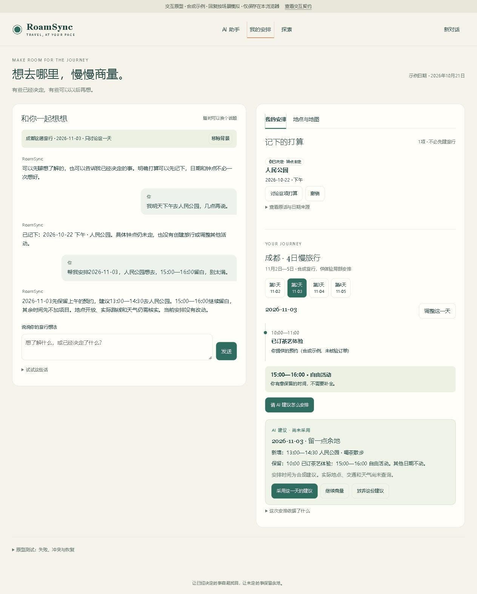

# RoamSync 自然助手交互审计与原型

2026-10-21。基于正式源码当前工作区完成；产品业务代码未改，未部署。

推荐阅读顺序：[审计](AUDIT.md) → [交互契约](INTERACTION_CONTRACT.md) → 操作原型 → [最小工程改动](IMPLEMENTATION_PLAN.md)。原型展示目标行为，不表示已接入真实模型、地图、数据库或产品 API。

## 运行

在 `E:/Study/RoamSync` 执行：

```powershell
python docs/ux/natural-assistant-20261021/prototype/serve.py
```

打开 http://localhost:3087/prototype/ 。仅监听本机；不使用 3000 产品端口。可用 `--port 3088` 换端口。浏览器仅用独立命名空间 localStorage 保存合成原型数据，重置不影响产品。不要直接双击 HTML：浏览器模块需要 HTTP。

```powershell
node --test docs/ux/natural-assistant-20261021/prototype/model.test.mjs
node --check docs/ux/natural-assistant-20261021/prototype/app.mjs
```

## 五分钟走查

1. 在“试试这些话”选一句知识问答，点击发送：回答，不产生打算。
2. 发送“我明天下午去人民公园，几点再说。”：右侧出现10月22日下午的打算，钟点未定；可撤销。刷新、新对话后仍可找到，新对话焦点为空。原型固定今天为2026-10-21。
3. 在四日旅行的第二天点击“请 AI 建议怎么安排”：出现尚未采用的建议；上午用户提供的预约、下午留白仍保留。点击“继续商量”，建议仍在；点击采用后正式示例日程才出现人民公园。
4. 展开底部“原型测试”，模拟别处修改日程：旧建议过期、采用禁用；可重新生成。勾选下一次保存失败，发送“记下宽窄巷子，日期没定。”：不能报已保存，重试后才新增。
5. 在探索页讨论一个地点，再浏览另一个地点，问“这里怎么样？”：展示两个对象供选择。查询路线前必须明确起点；失败开关不产生距离、ETA 或导航状态。

直接时间编辑在采用人民公园建议后展开；它同样检查预约和留白冲突。原型仅支持这些合成演示句式，未识别内容会说明限制；无法证明真实 AI 理解任意表达。日期修改、转入旅行事务、完整多候选协调、跨设备同步及真实附近查询未实现。

## 验证材料

- `evidence/source-snapshot.json`：源码路径、行号、哈希、HEAD 和证据边界。
- `evidence/verification.json`：实际执行的状态测试、浏览器走查、响应式检查和当前服务限制。
- `evidence/model-tests.tap`：原型14项状态测试的实际输出。
- `evidence/prototype-desktop.png`、`prototype-mobile.png`：浏览器截图；没有拿设计图片替代运行结果。



## 需要真实用户验证的假设

“明确打算直接保存＋可撤销”是否符合用户预期，尚不能由作者走查证明。建议用6个小任务验证：咨询不保存、明确决定但没时间、两个同名地点、只排某一天、继续讨论、保存失败重试。记录是否找对已保存项、是否理解正式日程未变、是否能自行恢复；不先向参与者讲数据状态术语。再根据结果决定卡片密度和反馈频率。
